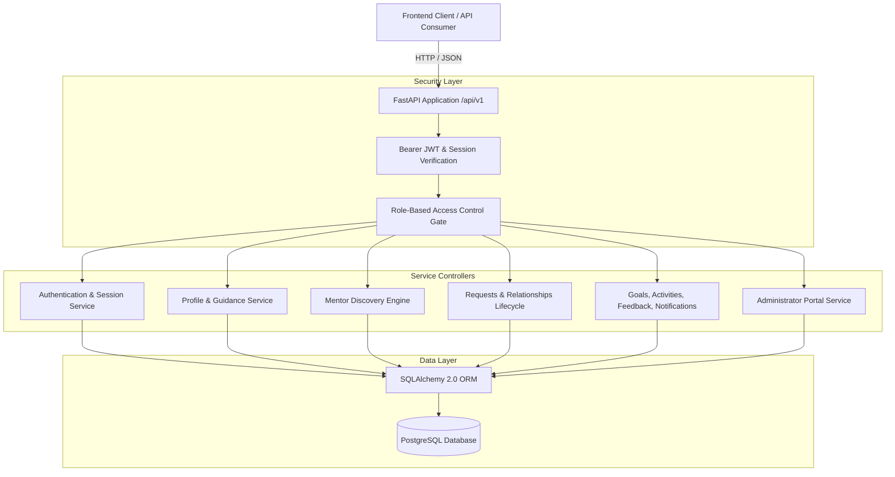

# Rock Starz Backend Architecture & Overview

Core backend documentation for the **Student Mentoring and Career Support Platform** (Team Rock Starz, SE-SEP2026-Team-046).

---

## 1. Documentation Index

The backend documentation is divided into specialized modules:

- [Database Architecture & Migrations](file:///c:/Users/Admin/AppData/Local/GitHubDesktop/app-3.6.6/Desktop/SE-SEP2026-Team-046/docs/backend/database.md): Schema models, relationships, indexing, and Alembic versioning.
- [REST API Specification](file:///c:/Users/Admin/AppData/Local/GitHubDesktop/app-3.6.6/Desktop/SE-SEP2026-Team-046/docs/backend/api-specification.md): Complete endpoint contract, RBAC matrices, request/response formats, and error codes.
- [Setup & Deployment Guide](file:///c:/Users/Admin/AppData/Local/GitHubDesktop/app-3.6.6/Desktop/SE-SEP2026-Team-046/docs/backend/setup-and-deployment.md): Environment variables, PostgreSQL setup, database migration, admin seeding, and server execution.

---

## 2. System Overview & Architecture

The Rock Starz backend is an asynchronous, transactional REST service developed with **FastAPI** and **PostgreSQL**. The service exposes versioned endpoints under `/api/v1` and enforces strict role-based separation of concerns across Students, Mentors, and Administrators.

---

## 3. Technology Stack

| Layer | Technology | Version | Purpose |
|---|---|---|---|
| Runtime | Python | `>=3.12` | Core application execution environment |
| Web Framework | FastAPI | `0.163.2` | High-performance asynchronous REST API framework |
| ASGI Web Server | Uvicorn | `0.54.0` | Production ASGI web server |
| Relational Database | PostgreSQL | `>=14` | Primary persistent transactional relational datastore |
| ORM | SQLAlchemy | `2.0.58` | Object-Relational Mapping, query compilation & connection pool |
| Schema Migrations | Alembic | `1.20.1` | Declarative, version-controlled database schema migrations |
| DB Driver | psycopg (v3) | `3.3.9` | High-performance PostgreSQL database adapter |
| Data Validation | Pydantic | `2.14.3` | Request body, query string, and response schema enforcement |
| Password Hashing | pwdlib + Argon2 | `0.4.2` | Secure key derivation and password hashing |
| Token Security | PyJWT | `2.15.1` | Cryptographic JWT token encoding, decoding, and signing |
| Email Validator | email-validator | `2.4.0` | RFC-compliant email address validation |

---

## 4. Security & Role-Based Access Control (RBAC)

The system implements zero-trust role-based authorization across four distinct client roles:

1. **Anonymous Callers**:
   - Permitted: System health checks (`GET /health`), registration (`POST /auth/register`), login (`POST /auth/login`), guidance area listing (`GET /guidance-areas`), and public mentor directory (`GET /public/mentors`).
   - Forbidden: All user management, personal profiles, requests, relationships, goals, and administrative endpoints (strictly HTTP 401).
2. **Students**:
   - Dedicated profile containing academic level, career objectives, and guidance area selections.
   - Allowed: Discovering mentors, sending structured requests, participating in goals/activities/feedback, and managing personal notifications.
   - Forbidden: Rejecting requests, closing relationships, creating guidance areas, or accessing admin tools (strictly HTTP 403).
3. **Mentors**:
   - Dedicated profile containing professional background, mentor classification, max mentee capacity, and guidance expertise.
   - Allowed: Accepting/rejecting incoming requests, managing active mentorships, logging activities, closing relationships, and exchanging feedback.
   - Forbidden: Sending mentoring requests to other mentors or performing administrative actions.
4. **Administrators**:
   - Full governance access: Managing guidance areas (create, update, deactivate), auditing user accounts, and approving/rejecting mentor verification applications.
   - Enforced Privacy Boundary: Administrators can monitor aggregate metrics and user records but are strictly prohibited from inspecting private mentoring messages or session notes.
