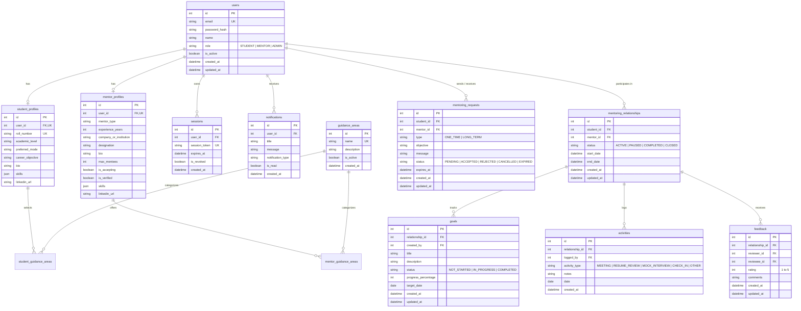

# Database Architecture & Migrations

Comprehensive relational database documentation for the **Rock Starz Backend** (PostgreSQL).

---

## 1. Entity-Relationship Diagram (ERD)



---

## 2. Table Specifications & Constraints

### 2.1 `users` Table
Stores authentication credentials and high-level role mapping.
- `id` (Integer, Primary Key, Auto-increment)
- `email` (String(255), Unique, Not Null, Indexed): Lowercase normalized email.
- `password_hash` (String(255), Not Null): Argon2id password hash.
- `name` (String(100), Not Null): Display name (min 2 chars).
- `role` (Enum, Not Null): `STUDENT`, `MENTOR`, or `ADMIN`.
- `is_active` (Boolean, Default: True): Deactivation toggle for governance.
- `created_at` / `updated_at` (DateTime with Timezone).

### 2.2 `student_profiles` Table
- `id` (Integer, Primary Key)
- `user_id` (Integer, Foreign Key `users.id`, Unique, Not Null)
- `roll_number` (String(32), Unique, Not Null): IITM BS student roll number format.
- `academic_level` (String(50)): e.g., Foundation, Diploma, BSc, BS Degree.
- `preferred_mode` (String(50)): e.g., Virtual, In-person, Hybrid.
- `career_objective` (Enum): `PLACEMENT`, `HIGHER_STUDIES`, `ENTREPRENEURSHIP`, `CAREER_CLARITY`.
- `bio` (Text): Background information and goals.
- `skills` (JSON / Array of Strings): Declared student skills.
- `linkedin_url` (String(255)): Optional LinkedIn URL.

### 2.3 `mentor_profiles` Table
- `id` (Integer, Primary Key)
- `user_id` (Integer, Foreign Key `users.id`, Unique, Not Null)
- `mentor_type` (Enum, Not Null): `Recent Graduate`, `Industry Professional`, `Research Mentor`, `Entrepreneur`, `Faculty`.
- `experience_years` (Integer, Default 0): Checked `>= 0 AND <= 60`.
- `company_or_institution` (String(150)): Workplace or university affiliation.
- `designation` (String(100)): Professional title.
- `max_mentees` (Integer, Default 3): Range `1` to `20`. Cannot be reduced below currently occupied active relationships.
- `is_accepting` (Boolean, Default True): Mentor availability switch.
- `is_verified` (Boolean, Default False): Administrative approval gate. Unverified mentors remain hidden from student discovery.

### 2.4 `guidance_areas` & Association Tables
- `guidance_areas`: System taxonomies (`id`, `name` (Unique), `description`, `is_active`).
- `student_guidance_areas`: Composite Primary Key (`student_profile_id`, `guidance_area_id`).
- `mentor_guidance_areas`: Composite Primary Key (`mentor_profile_id`, `guidance_area_id`).

### 2.5 `mentoring_requests` Table
- `id` (Integer, Primary Key)
- `student_id` (Integer, Foreign Key `users.id`, Not Null)
- `mentor_id` (Integer, Foreign Key `users.id`, Not Null)
- `type` (Enum): `ONE_TIME` or `LONG_TERM`.
- `objective` (String(500), Not Null): Clear statement of purpose.
- `message` (Text, Not Null): Introductory message (20-2000 chars).
- `status` (Enum): `PENDING`, `ACCEPTED`, `REJECTED`, `CANCELLED`, `EXPIRED`.
- `expires_at` (DateTime): Default 48 hours from creation. An unanswered request transitions to `EXPIRED`.

### 2.6 `mentoring_relationships` Table
- `id` (Integer, Primary Key)
- `student_id` (Integer, Foreign Key `users.id`, Not Null)
- `mentor_id` (Integer, Foreign Key `users.id`, Not Null)
- `status` (Enum): `ACTIVE`, `PAUSED`, `COMPLETED`, `CLOSED`.
- Enforces strict transition rules:
  - `ACTIVE` <-> `PAUSED` (both student and mentor can pause/resume).
  - `ACTIVE` -> `COMPLETED` (either party can mark as completed).
  - `ACTIVE` -> `CLOSED` (mentor-only action).
  - Terminal statuses (`COMPLETED`, `CLOSED`) are immutable and cannot be reopened.

### 2.7 Engagement Tables (`goals`, `activities`, `feedback`, `notifications`)
- `goals`: Tracks milestones and progress percentage (0-100%).
- `activities`: Timestamped interaction records (Meeting, Resume Review, Mock Interview, Check-in).
- `feedback`: Bidirectional reviews with integer rating constraint `1 <= rating <= 5`.
- `notifications`: Queued user events with read receipt status.

---

## 3. Migration History (Alembic)

Database migrations reside in `backend/alembic/versions/` and guarantee deterministic schema setup:

| Revision ID | Name / Description | Core Schema Changes |
|---|---|---|
| **`0001`** | `create_account_and_profile_foundation` | Creates `users`, `student_profiles`, `mentor_profiles`, `guidance_areas`, `student_guidance_areas`, and `mentor_guidance_areas`. Sets up foreign keys and unique constraints. |
| **`0002`** | `add_authentication_sessions` | Introduces the `sessions` table to support revocable JWT login sessions, tracking active token identifiers and session invalidation. |
| **`0003`** | `complete_profile_fields` | Adds secondary profile attributes: LinkedIn URLs, JSON skills arrays, academic level definitions, and communication preferences. |
| **`0004`** | `add_mentoring_requests_and_relationships` | Adds `mentoring_requests` and `mentoring_relationships` with state transition enums and 48-hour expiration timestamping. |
| **`0005`** | `add_mentoring_engagement` | Implements collaborative engagement entities: `goals`, `activities`, `feedback` (1-5 star rating enforcement), and user `notifications`. |

---

## 4. Database Management Commands

```bash
# Apply all pending migrations to database
alembic upgrade head

# Roll back the latest migration
alembic downgrade -1

# View migration history and current head
alembic history --verbose
alembic current
```
