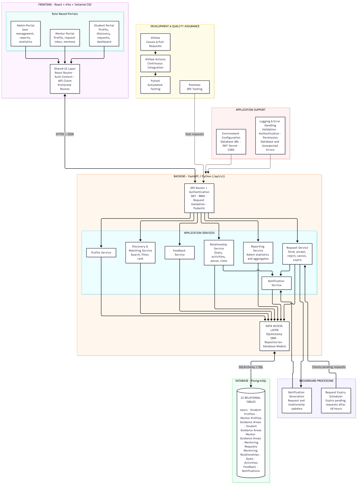
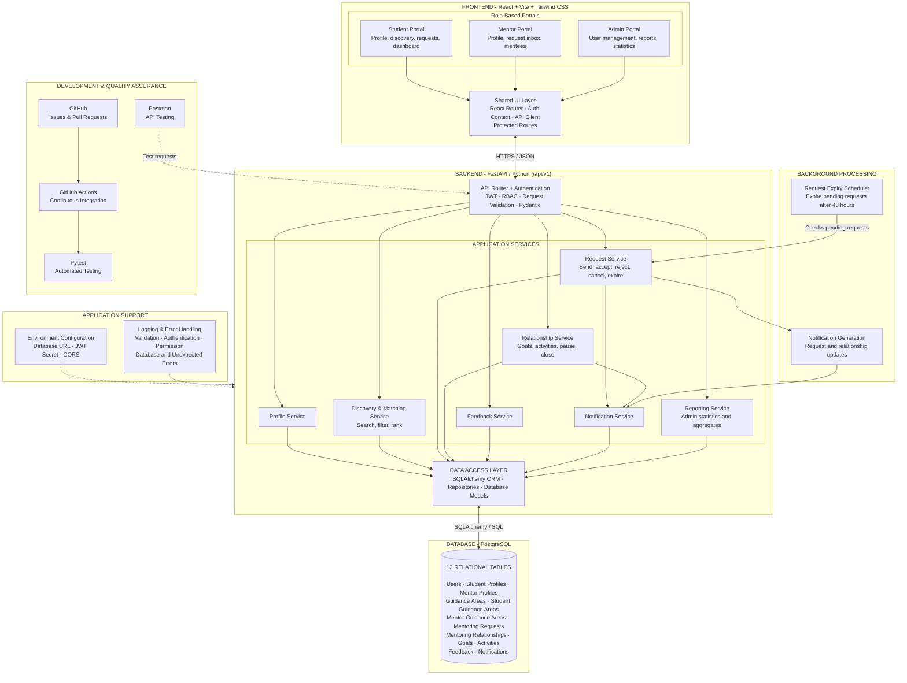

# Component Architecture – Rock Starz

## 1. Introduction

The Rock Starz platform is designed as a web-based student mentoring and career guidance system. It connects students with suitable mentors, supports mentoring requests and relationships, and provides administrative facilities for managing users and monitoring platform activity.

The system follows a layered architecture consisting of a React-based frontend, a FastAPI backend, a PostgreSQL relational database, background processing components, and development and quality assurance tools.

The architecture separates user-facing interfaces, application logic, data access, and database storage. This separation supports modular development, easier maintenance, independent testing, and future enhancements.

## 2. Architecture Overview

The application is organized into the following major components:

1. Frontend – React, Vite and Tailwind CSS.
2. Backend – FastAPI and Python.
3. Application Services – Independent services handling specific business responsibilities.
4. Data Access Layer – SQLAlchemy ORM, repositories and database models.
5. Database – PostgreSQL with 12 relational tables.
6. Background Processing – Request expiry and notification generation.
7. Application Support – Environment configuration, logging and error handling.
8. Development and Quality Assurance – Postman, Pytest, GitHub and GitHub Actions.

### 2.1 Component Architecture Diagram

The following diagram illustrates the major components, their responsibilities, and their interactions.

The frontend communicates with the backend through HTTPS using JSON-based API requests. The backend processes requests through its API and application service layers, accesses persistent data through the data access layer, and interacts with the PostgreSQL database.

Background processing handles time-dependent operations, while the development and quality assurance components support testing and continuous integration.

## 3. Frontend Architecture

### 3.1 Technology Stack

- React – Component-based frontend development.
- Vite – Development server and build tooling.
- Tailwind CSS – Utility-first styling framework.
- React Router – Client-side navigation and route management.

The frontend provides separate role-based portals for students, mentors, and administrators. Each portal exposes functionality relevant to its respective user role.

### 3.2 Role-Based Portals

**A. Student Portal**

The Student Portal allows students to access mentoring and career guidance facilities.

Its responsibilities include:

- Student profile management.
- Mentor discovery.
- Searching and filtering mentors.
- Sending and managing mentoring requests.
- Accessing the mentoring dashboard.
- Viewing relevant mentoring information.

**B. Mentor Portal**

The Mentor Portal provides mentors with facilities to manage their mentoring activities.

Its responsibilities include:

- Mentor profile management.
- Receiving and viewing mentoring requests.
- Accepting or rejecting requests.
- Managing assigned mentees.
- Accessing mentoring relationship information.

**C. Admin Portal**

The Admin Portal provides administrative facilities for monitoring and managing the platform.

Its responsibilities include:

- User management.
- Monitoring platform participation.
- Accessing reports and statistics.
- Viewing aggregated information about mentoring activities.

### 3.3 Shared UI Layer

The three portals use a shared frontend infrastructure layer.

It consists of:

- **React Router:** Handles navigation between application pages and portals.
- **Authentication Context:** Maintains authentication-related frontend state.
- **API Client:** Provides a common mechanism for communicating with backend APIs.
- **Protected Routes:** Restricts access to application routes based on authentication and authorization requirements.

The shared layer avoids unnecessary duplication of common frontend functionality.

## 4. Backend Architecture

### 4.1 Technology Stack

- Python – Backend programming language.
- FastAPI – Backend web framework.
- Pydantic – Request and data validation.
- JWT – Token-based authentication.
- RBAC – Role-Based Access Control.
- SQLAlchemy – Object-relational mapping and database interaction.
- PostgreSQL – Relational database management system.

The backend exposes versioned REST API endpoints under `/api/v1`.

### 4.2 API Router and Authentication Layer

The API Router acts as the primary entry point for frontend requests.

Its responsibilities include:

- Receiving HTTP requests from the frontend.
- Routing requests to the appropriate application service.
- Handling authentication using JWT.
- Enforcing role-based access control.
- Validating incoming request data.
- Using Pydantic models for request and response validation.

The API layer separates request handling and access control from the actual business logic implemented by application services.

### 4.3 Application Services

The application service layer contains independent modules responsible for the platform's main business operations.

**A. Profile Service**

Responsible for managing student and mentor profile information.

Functions include:

- Creating and updating profiles.
- Retrieving profile information.
- Managing profile-related details.

**B. Discovery and Matching Service**

Responsible for helping students discover suitable mentors.

Functions include:

- Searching mentors.
- Filtering mentor profiles.
- Matching student requirements with mentor expertise.
- Ranking and presenting relevant mentor results.

The matching process considers relevant guidance areas and profile information.

**C. Request Service**

Responsible for managing mentoring requests between students and mentors.

Functions include:

- Sending mentoring requests.
- Accepting requests.
- Rejecting requests.
- Cancelling requests.
- Expiring pending requests.

The platform defines a 48-hour expiry period for pending mentoring requests, which is handled with the support of background processing.

**D. Relationship Service**

Responsible for managing established mentoring relationships.

Functions include:

- Managing mentoring relationship information.
- Tracking mentoring goals.
- Recording mentoring activities.
- Pausing mentoring relationships.
- Closing mentoring relationships.

This service supports continuity and tracking throughout the mentoring process.

**E. Feedback Service**

Responsible for handling feedback associated with mentoring interactions.

Its responsibilities include:

- Receiving feedback.
- Managing feedback records.
- Supporting feedback retrieval for relevant application operations.

**F. Notification Service**

Responsible for managing notifications generated by relevant application events.

These include:

- Mentoring request updates.
- Request acceptance or rejection notifications.
- Mentoring relationship updates.
- Other relevant platform notifications.

**G. Reporting Service**

Responsible for generating administrative reports and aggregated statistics.

Its responsibilities include:

- Retrieving relevant platform activity information.
- Generating participation statistics.
- Supporting administrative monitoring.
- Providing aggregated information for reports.

## 5. Data Access Layer

The Data Access Layer provides the interface between application services and persistent database storage.

It consists of:

- **SQLAlchemy ORM:** Maps application objects to relational database structures and supports database operations.
- **Repositories:** Encapsulate data retrieval, insertion, updating and deletion operations.
- **Database Models:** Represent the application's relational entities and their relationships.

The application services interact with the database through this layer rather than directly implementing database queries throughout the business logic.

This separation improves maintainability and makes it easier to modify data access implementations independently of application services.

## 6. Database Architecture

### 6.1 Database Technology

The platform uses PostgreSQL as its relational database management system.

The database contains 12 relational tables representing the major entities and activities involved in student mentoring.

### 6.2 Database Tables

| No. | Table | Purpose |
|---|---|---|
| 1 | Users | Stores common user information. |
| 2 | Student Profiles | Stores student-specific profile information. |
| 3 | Mentor Profiles | Stores mentor-specific profile information. |
| 4 | Guidance Areas | Stores available career and guidance categories. |
| 5 | Student Guidance Areas | Associates students with their selected guidance areas. |
| 6 | Mentor Guidance Areas | Associates mentors with their areas of expertise. |
| 7 | Mentoring Requests | Stores requests initiated by students and their status. |
| 8 | Mentoring Relationships | Stores established mentoring relationships. |
| 9 | Goals | Stores goals associated with mentoring relationships. |
| 10 | Activities | Records mentoring-related activities. |
| 11 | Feedback | Stores feedback associated with mentoring interactions. |
| 12 | Notifications | Stores notifications generated by application events. |

The relational structure supports connections between users, profiles, guidance areas, requests, mentoring relationships, activities, feedback and notifications.

The Data Access Layer uses SQLAlchemy to interact with these database tables.

## 7. Background Processing

Certain platform operations require processing outside the immediate frontend request-response cycle.

The architecture includes two background processing components.

### 7.1 Request Expiry Scheduler

The Request Expiry Scheduler periodically checks pending mentoring requests.

Its primary responsibility is to identify requests that have remained pending beyond the defined 48-hour period and trigger the expiry process.

The scheduler interacts with the Request Service, which handles the relevant request status updates.

### 7.2 Notification Generation

The Notification Generation component supports the generation of notifications following relevant application events.

Examples include:

- New mentoring requests.
- Request acceptance or rejection.
- Mentoring relationship updates.

Generated notifications are handled by the Notification Service and stored through the Data Access Layer.

## 8. Application Support Components

### 8.1 Environment Configuration

The application uses environment-based configuration to manage deployment-specific settings.

The architecture identifies the following configuration parameters:

- Database URL.
- JWT Secret.
- CORS configuration.

Environment-based configuration helps separate application settings from source code and supports different development and deployment environments.

### 8.2 Logging and Error Handling

The application includes centralized logging and error-handling support.

The architecture covers errors associated with:

- Request validation.
- Authentication.
- Permission and authorization checks.
- Database operations.
- Unexpected application failures.

These mechanisms help with debugging, application monitoring and consistent error handling.

## 9. Development and Quality Assurance

The development and quality assurance layer contains tools used to develop, test and maintain the application.

### 9.1 Postman

Postman is used for API testing.

It supports:

- Sending HTTP requests to backend endpoints.
- Validating API responses.
- Testing request and response formats.
- Checking authentication-related API behaviour.

### 9.2 Pytest

Pytest is used for automated backend testing.

It supports:

- Testing application functions.
- Validating service behaviour.
- Testing API functionality.
- Detecting regressions during development.

### 9.3 GitHub

GitHub is used for source code management and team collaboration.

It supports:

- Repository management.
- Issue tracking.
- Feature branches.
- Pull requests.
- Code review.
- Version control.

### 9.4 GitHub Actions

GitHub Actions provides continuous integration support.

The architecture illustrates the following workflow:

1. Code changes are pushed to GitHub.
2. GitHub Actions initiates the configured CI workflow.
3. Automated tests are executed using Pytest.
4. Test results are used to identify potential issues before integration.

## 10. System Communication and Data Flow

The architecture follows a layered communication model.

### 10.1 Frontend-to-Backend Communication

1. A user interacts with the relevant role-based portal.
2. The shared frontend layer handles navigation, authentication state and API communication.
3. The API Client sends an HTTPS request containing JSON data to the backend.
4. The API Router receives and validates the request.
5. Authentication and authorization checks are applied.
6. The request is routed to the appropriate application service.

### 10.2 Backend-to-Database Communication

1. The application service performs the required business operation.
2. The service accesses the Data Access Layer.
3. The repository and SQLAlchemy ORM handle the database interaction.
4. PostgreSQL performs the relevant relational database operation.
5. The result is returned through the Data Access Layer to the application service.
6. The backend prepares the appropriate API response.

### 10.3 Mentoring Request Workflow

The mentoring request workflow can be summarized as follows:

1. A student discovers a suitable mentor through the Discovery and Matching Service.
2. The student sends a mentoring request through the frontend.
3. The API Router forwards the request to the Request Service.
4. The Request Service processes and stores the request.
5. The Notification Service handles the relevant notification.
6. The mentor views the request through the Mentor Portal.
7. The mentor accepts or rejects the request.
8. If accepted, the Relationship Service manages the resulting mentoring relationship.
9. If the request remains pending beyond 48 hours, the Request Expiry Scheduler triggers the expiry process.

### 10.4 Mentoring Relationship Workflow

1. An accepted mentoring request leads to an established mentoring relationship.
2. The Relationship Service manages the relationship.
3. Goals and activities are associated with the relationship.
4. Relevant relationship updates can trigger notifications.
5. Feedback is handled through the Feedback Service.
6. Administrative reporting can retrieve relevant aggregated information.

## 11. Architectural Design Considerations

The architecture follows several important design principles.

**Separation of Concerns:** Frontend, backend, data access and database responsibilities are separated into distinct layers.

**Modularity:** Application services are divided according to business responsibilities, allowing individual modules to be developed and maintained independently.

**Reusability:** The shared frontend layer and common backend infrastructure reduce duplication.

**Role-Based Access:** Separate student, mentor and administrator portals provide role-specific interfaces, while backend authentication and authorization enforce access control.

**Maintainability:** Centralized data access, configuration, logging and error handling support easier maintenance.

**Testability:** Postman and Pytest support API-level and automated testing, while GitHub Actions provides continuous integration.

**Scalability Considerations:** The separation of application services, data access and background processing provides a foundation for future enhancements and scaling.

## 12. Conclusion

The proposed component architecture provides a modular structure for the Rock Starz student mentoring platform.

The React frontend provides role-specific interfaces, while the FastAPI backend handles authentication, business logic and API operations. Application services manage individual platform functionalities, and the Data Access Layer provides structured interaction with the PostgreSQL database.

Background processing supports time-dependent request expiry and notification generation. Application support components and development tools contribute to configuration management, error handling, automated testing and continuous integration.

Overall, the architecture establishes a clear separation of responsibilities and provides a maintainable foundation for implementing and integrating the platform's major features.

## 13. Diagram Source

The complete Mermaid source used to generate the component architecture diagram is included below. It is maintained alongside the exported PNG to support future modifications and regeneration of the diagram.

---
