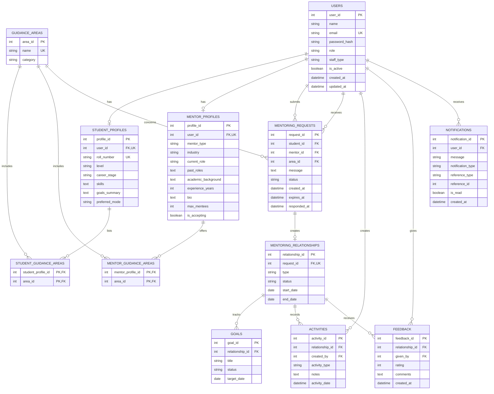

# Database Design – Rock Starz

## 1. Overview

This document describes the relational database design for the Rock Starz student mentoring platform. The database uses PostgreSQL and supports user accounts, student and mentor profiles, guidance-area preferences, mentoring requests, mentoring relationships, goals, activities, feedback and notifications.

The database design consists of 12 relational tables. The Entity Relationship (ER) diagram illustrates the entities, their attributes, primary keys, foreign keys, unique keys and relationships.

## 2. Entity Relationship Diagram

The ER diagram represents the logical database structure and the relationships between the different entities. The Mermaid source is included below to allow future modifications to the diagram.

## 3. Database Tables

The database consists of the following 12 relational tables.

| No. | Table | Description |
|---|---|---|
| 1 | USERS | Stores common account information, login credentials, role and account status. |
| 2 | STUDENT_PROFILES | Stores student-specific information such as roll number, level, career stage, skills, goals and preferred mentoring mode. |
| 3 | MENTOR_PROFILES | Stores mentor information such as mentor type, industry, current role, experience, biography, mentoring capacity and availability. |
| 4 | GUIDANCE_AREAS | Maintains the available career and mentoring guidance areas. |
| 5 | STUDENT_GUIDANCE_AREAS | Maps student profiles to the guidance areas they are interested in. |
| 6 | MENTOR_GUIDANCE_AREAS | Maps mentor profiles to the guidance areas they can offer. |
| 7 | MENTORING_REQUESTS | Stores student requests to mentors, including the selected guidance area, message, status and relevant timestamps. |
| 8 | MENTORING_RELATIONSHIPS | Stores the mentoring relationship created from an accepted request, including its type, status and dates. |
| 9 | GOALS | Stores goals associated with a mentoring relationship. |
| 10 | ACTIVITIES | Records activities and notes associated with a mentoring relationship and identifies the user who created each activity. |
| 11 | FEEDBACK | Stores ratings and comments submitted for a mentoring relationship, together with the user who provided the feedback. |
| 12 | NOTIFICATIONS | Stores notifications for users, including their type, read status and a reference to the related application entity. |

## 4. Entity Relationships

The database establishes the following relationships between its entities:

- **Users and Profiles:** A user can have a student profile or a mentor profile. The `user_id` in each profile table is a foreign key and unique, allowing at most one profile of that type per user.
- **Profiles and Guidance Areas:** Student profiles and mentor profiles have many-to-many relationships with guidance areas. The `STUDENT_GUIDANCE_AREAS` and `MENTOR_GUIDANCE_AREAS` junction tables implement these relationships.
- **Users and Mentoring Requests:** A user submits a request as a student, while another user receives it as a mentor. Each request is associated with one guidance area.
- **Requests and Relationships:** A mentoring request can create zero or one mentoring relationship. The unique `request_id` in `MENTORING_RELATIONSHIPS` ensures that a request cannot create multiple relationship records.
- **Relationships and Supporting Records:** A mentoring relationship can have multiple goals, activities and feedback records.
- **Users and Activities:** Each activity identifies the user who created it.
- **Users and Feedback:** Each feedback record identifies the user who submitted it.
- **Users and Notifications:** A user can receive multiple notifications.

## 5. Primary Keys, Foreign Keys and Unique Keys

The database uses different key types to maintain record identification and referential integrity.

- **Primary Keys (PK):** Uniquely identify individual records in each table.
- **Foreign Keys (FK):** Maintain references between related tables and ensure that associated records refer to valid parent records.
- **Unique Keys (UK):** Prevent duplicate values where uniqueness is required, such as account email, student roll number and profile ownership.
- **Composite Primary Keys:** The two guidance-area junction tables use pairs of identifiers as their primary keys. This prevents the same profile from being associated with the same guidance area more than once.

The ER diagram marks these keys beside the corresponding attributes.

## 6. Supplementary PostgreSQL Constraints

The `postgresql-constraints.sql` file contains supplementary PostgreSQL constraints and indexes that complement the ER design.

These constraints provide additional validation at the database level, ensuring that invalid values and duplicate records are prevented wherever applicable.

### 6.1 User Role Validation

The `chk_users_role` CHECK constraint restricts the `role` attribute in the `USERS` table to the following values:

- `STUDENT`
- `MENTOR`
- `ADMIN`

This prevents unsupported role values from being stored in the database.

### 6.2 Profile Uniqueness Constraints

The SQL file defines the following unique constraints:

- `uq_student_profiles_user`: Ensures that a user can have at most one student profile.
- `uq_student_profiles_roll`: Ensures that student roll numbers are unique.
- `uq_mentor_profiles_user`: Ensures that a user can have at most one mentor profile.

These constraints reinforce the profile relationships represented in the ER diagram.

### 6.3 Mentoring Request Status Validation

The `chk_mentoring_request_status` CHECK constraint restricts mentoring request statuses to:

- `PENDING`
- `ACCEPTED`
- `REJECTED`
- `EXPIRED`
- `CANCELLED`

This ensures consistency in request status values and prevents unsupported states from being stored.

### 6.4 Mentoring Request Indexes

The following indexes are created on the `MENTORING_REQUESTS` table:

- `ix_requests_student` on `student_id`
- `ix_requests_mentor` on `mentor_id`
- `ix_requests_status` on `status`
- `ix_requests_expiry` on `expires_at`

These indexes improve query performance when retrieving requests by student or mentor, filtering by status and identifying requests that are due for expiry.

### 6.5 Mentoring Relationship Constraints

Two constraints are defined for the `MENTORING_RELATIONSHIPS` table:

- `uq_relationship_request`: Ensures that each mentoring request can create at most one mentoring relationship by enforcing uniqueness on `request_id`.
- `chk_relationship_status`: Restricts relationship statuses to `ACTIVE`, `PAUSED`, `COMPLETED` and `CLOSED`.

These constraints maintain consistency between mentoring requests and their resulting relationships.

### 6.6 Feedback Rating Validation

The `chk_feedback_rating` CHECK constraint ensures that feedback ratings are between 1 and 5, inclusive.

This prevents invalid rating values from being stored.

### 6.7 Notification Index

The composite index `ix_notifications_user_read` is created on `user_id` and `is_read` in the `NOTIFICATIONS` table.

It supports efficient retrieval of notifications for individual users and filtering based on whether notifications have been read.

### 6.8 Application-Level Rules

Certain business rules require application-level validation and transaction handling rather than relying solely on database constraints.

These include:

1. A mentoring relationship must be created only after its associated request has been accepted.
2. Requests can be accepted, rejected, cancelled or expired only when their current status permits the transition. In particular, acceptance and expiry must apply only to pending requests.
3. Request acceptance and mentoring relationship creation must occur within a single database transaction to prevent inconsistent records.
4. `reference_type` and `reference_id` in the `NOTIFICATIONS` table must be validated by the application against the corresponding application entity.

Pending mentoring requests are intended to expire after 48 hours. The expiry process must verify that a request is still pending before updating its status.

## 7. Implementation Notes

- PostgreSQL is the selected relational database for this design.
- The ER diagram represents the intended database structure and key relationships.
- The supplementary SQL file should be reviewed against the existing SQLAlchemy models and migration history before execution.
- Some uniqueness rules are already represented in the ER diagram. The corresponding SQL constraints should not be added again if they already exist in the database schema.
- Schema changes should be applied through the project's migration workflow.
- Existing data should be checked before adding CHECK or UNIQUE constraints, as incompatible records may cause a migration to fail.
- The SQL file is a supplementary implementation reference and should not be executed blindly against an existing database.

## 8. Deliverables

This folder contains:

- `database-design.md` – Database design documentation, embedded Mermaid ER diagram source, table descriptions, relationships and constraint explanations.
- `database-design.png` – Rendered Entity Relationship diagram.
- `postgresql-constraints.sql` – Supplementary PostgreSQL constraints, indexes and application-level rule notes.