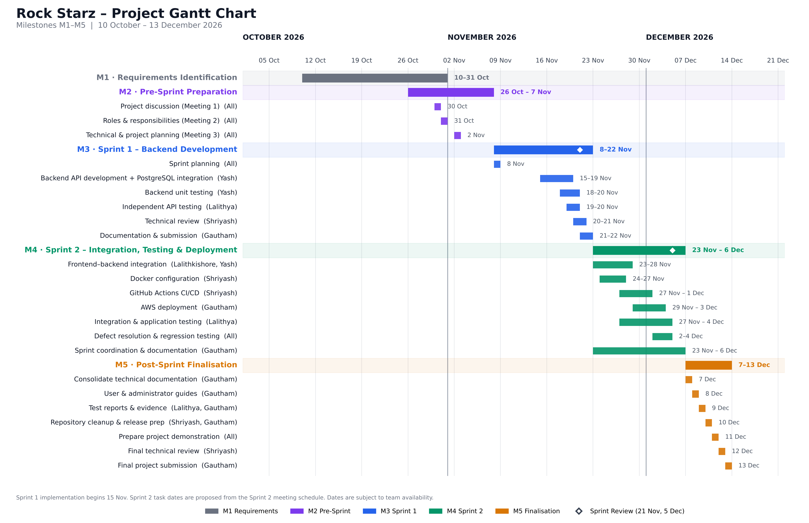

# Rock Starz – Project Gantt Chart

## 1. Introduction

This document presents the project schedule of Rock Starz through a Gantt chart. It provides a visual representation of the five project milestones, two development sprints, major activities, task durations and planned completion periods.

The schedule follows the Agile Scrum-inspired execution model documented in `scrum-planning.md` and `scrum-schedule.md`.

## 2. Gantt Chart

The chart covers the project timeline from 10 October to 13 December 2026. Each milestone is shown as a colour-coded summary bar, with its key tasks, responsible members and dates listed beneath it. Diamonds mark the Sprint Reviews (21 November and 5 December).

## 3. Project Timeline

| Phase | Milestone | Planned Period | Focus |
|---|---|---|---|
| Requirements Identification | M1 | 10 – 31 October 2026 | User identification, user stories, pain-point analysis and research |
| Pre-Sprint Preparation | M2 | 26 October – 7 November 2026 | Project planning, role allocation, architecture, database design, frontend preparation and project scheduling |
| Sprint 1 | M3 | 8 – 22 November 2026 | Backend development, PostgreSQL integration and unit testing |
| Sprint 2 | M4 | 23 November – 6 December 2026 | Frontend-backend integration, testing, CI/CD and deployment |
| Post-Sprint Finalisation | M5 | 7 – 13 December 2026 | Final documentation, verification, demonstration and release preparation |

## 4. Major Activity Schedule

### 4.1 Milestone 2 – Pre-Sprint Preparation

**Period:** 26 October – 7 November 2026

The preparation phase establishes the project direction and prepares the team for development.

| Activity | Participants | Date |
|---|---|---|
| Project discussion (Meeting 1) | All members | 30 October |
| Roles and responsibilities (Meeting 2) | All members | 31 October |
| Technical and project planning (Meeting 3) | All members | 2 November |

Other M2 activities include component architecture and UML class diagram preparation, database design and ER diagram, frontend and API planning, Gantt chart and Kanban board preparation, and finalisation of the Scrum schedule and development workflow.

### 4.2 Milestone 3 – Sprint 1

**Period:** 8 – 22 November 2026

**Implementation begins:** 15 November 2026

| Activity | Responsible Member | Planned Period |
|---|---|---|
| Sprint planning | All members | 8 November |
| Backend API development and PostgreSQL integration | Yash | 15–19 November |
| Backend unit testing | Yash | 18–20 November |
| Independent API testing | Lalithya | 19–20 November |
| Technical review | Shriyash | 20–21 November |
| Documentation and submission | Gautham | 21–22 November |

Sprint Review and Technical Review take place on 21 November, followed by the Sprint Retrospective on 22 November.

### 4.3 Milestone 4 – Sprint 2

**Period:** 23 November – 6 December 2026

Task dates are scheduled around the Sprint 2 progress meetings in `scrum-schedule.md` so that tasks run in sequence rather than all at once.

| Activity | Responsible Member(s) | Proposed Period | Aligned Meeting |
|---|---|---|---|
| Frontend-backend integration | Lalithkishore and Yash | 23–28 November | 26 Nov – integration review |
| Docker configuration | Shriyash | 24–27 November | 29 Nov – Docker review |
| GitHub Actions CI/CD | Shriyash | 27 November – 1 December | 29 Nov – CI/CD workflow review |
| AWS deployment | Gautham | 29 November – 3 December | 2 Dec – deployment progress |
| Integration and application testing | Lalithya | 27 November – 4 December | 2 Dec – testing and defects |
| Defect resolution and regression testing | All members | 2–4 December | 4 Dec – regression check |
| Sprint coordination and documentation | Gautham | 23 November – 6 December | Throughout the sprint |

Sprint Review and Technical Review take place on 5 December, followed by the Sprint Retrospective on 6 December.

### 4.4 Milestone 5 – Post-Sprint Finalisation

**Period:** 7 – 13 December 2026

| Activity | Responsible Member(s) | Planned Date |
|---|---|---|
| Technical documentation consolidation | Gautham and contributors | 7 December |
| User and administrator guides | Gautham | 8 December |
| Testing report and evidence | Lalithya and Gautham | 9 December |
| Repository cleanup and release preparation | Shriyash and Gautham | 10 December |
| Project demonstration preparation | All members | 11 December |
| Final technical review | Shriyash | 12 December |
| Final project submission | Gautham | 13 December |

## 5. Schedule Management

- The Gantt chart provides the overall project schedule and milestone-level activity sequence.
- GitHub Projects is used to track individual tasks, assignments, priorities and progress.
- GitHub Issues define task objectives and acceptance criteria.
- Sprint meetings are used to review progress, identify blockers and coordinate dependencies.
- Task dates may be revised based on actual development progress and team availability.
- The accompanying `scrum-schedule.md` document maintains the detailed meeting schedule and activity register.

## 6. Deliverables

This folder contains:

- `gantt-chart.md` – Project schedule documentation, milestone periods and activity descriptions.
- `gantt-chart.png` – Visual Gantt chart representing the project timeline.