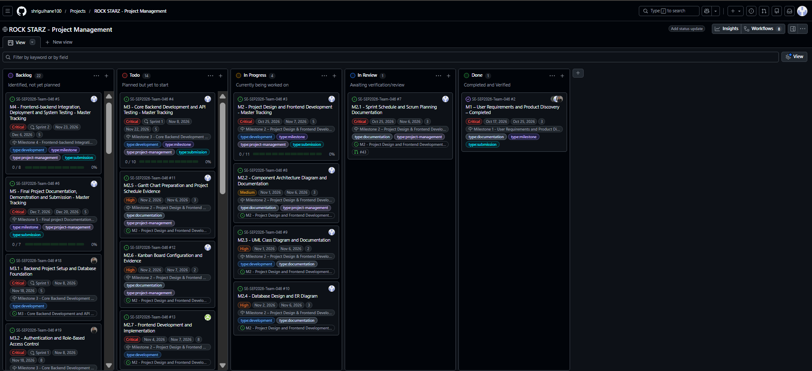
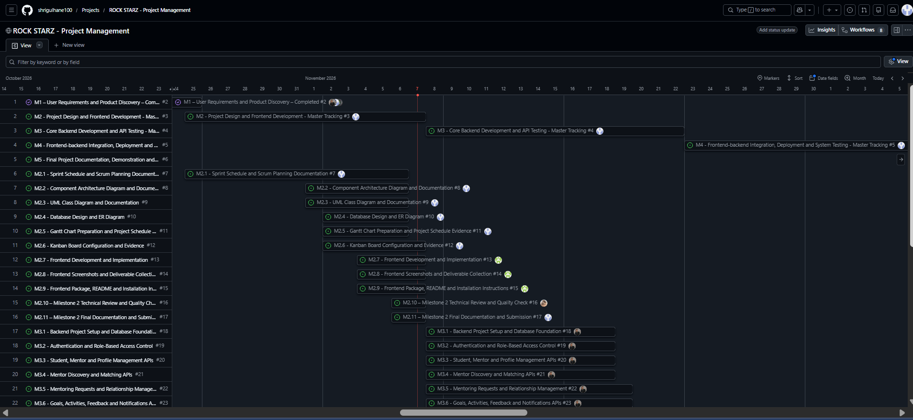
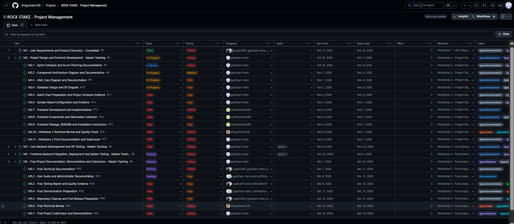

# Rock Starz – GitHub Projects and Kanban Board Configuration

## 1. Introduction

GitHub Projects is used as the central project management and task-tracking platform for the Rock Starz project.

It provides a unified workspace for organising project activities, assigning responsibilities, monitoring task progress, managing schedules and coordinating milestone deliverables.

The project uses three complementary views within GitHub Projects:

- **Board View:** Visualises tasks according to their current workflow status.
- **Roadmap View:** Displays project milestones and activities along a timeline.
- **Table View:** Provides a structured representation of tasks and their associated project attributes.

Together, these views support task-level tracking, schedule management and overall project coordination.

## 2. GitHub Projects Configuration

The Rock Starz project board is maintained using GitHub Projects and is connected to the project's GitHub repository.

Individual project activities are maintained as GitHub Issues and added to the project. Master tracking issues represent the five major milestones, while their associated sub-issues represent individual activities and deliverables.

The project uses the following organisational elements:

| Element | Purpose |
|---|---|
| GitHub Issues | Record individual tasks, objectives and acceptance criteria. |
| Master Issues | Represent milestone-level tracking activities. |
| Sub-issues | Break milestones into smaller, manageable tasks. |
| Assignees | Identify the team member responsible for a task. |
| Labels | Categorise tasks by type and purpose. |
| Status | Indicate the current stage of task execution. |
| Priority | Indicate the importance and urgency of tasks. |
| Sprint | Associate development activities with the relevant sprint. |
| Milestone | Connect tasks to the corresponding project milestone. |
| Dates | Support scheduling and progress monitoring. |

## 3. Board View – Kanban Workflow

The Board view groups project issues into columns according to their current status. Each issue is represented by a card containing relevant task information.

The project uses five workflow statuses:

| Status | Description |
|---|---|
| Backlog | Tasks identified but not yet planned for execution. |
| Todo | Tasks planned and ready to be started. |
| In Progress | Tasks currently being worked on by assigned team members. |
| In Review | Tasks awaiting technical review, verification or approval. |
| Done | Tasks completed and verified. |

### 3.1 Task Progression

The team follows this workflow:

1. New tasks are recorded and organised in Backlog.
2. Tasks selected for execution are moved to Todo.
3. Once work begins, the task is moved to In Progress.
4. After implementation, the task is moved to In Review.
5. Following successful verification, the task is moved to Done.

If a review identifies issues, the task can be returned to In Progress for corrections before being reviewed again.

### 3.2 Board Management

The board is updated throughout project execution.

- Team members update the status of their assigned issues as work progresses.
- Assignees are maintained to ensure responsibility is clear.
- Priority labels help identify critical and high-priority activities.
- Sprint and milestone fields provide information about the task's project phase.
- Tasks awaiting technical review are moved to In Review.
- Completed and verified activities are moved to Done.

The Project Manager monitors the board to identify pending tasks, ongoing work, review requirements and potential delays.

## 4. Roadmap View – Project Timeline

The Roadmap view provides a timeline-based representation of the project milestones and scheduled activities.

It displays the planned start and target dates of project work, allowing the team to observe the sequence and duration of activities.

The project roadmap includes:

- M1 – User Requirements and Product Discovery.
- M2 – Project Design and Frontend Development.
- M3 – Core Backend Development and API Testing.
- M4 – Frontend-Backend Integration, Deployment and System Testing.
- M5 – Final Project Documentation, Demonstration and Submission.

### 4.1 Roadmap Management

The roadmap is maintained by updating the date fields associated with project issues.

- Start Date represents the planned beginning of an activity.
- Target Date represents its planned completion.
- Master issues provide milestone-level schedule visibility.
- Sub-issues provide more detailed activity-level scheduling.
- Changes in task schedules can be reflected by updating the corresponding issue dates.

The Roadmap view helps the Project Manager monitor milestone progress, identify scheduling overlaps and coordinate activities across the two development sprints.

## 5. Table View – Structured Task Tracking

The Table view provides a consolidated representation of project issues and their associated attributes.

Unlike the Board view, which groups tasks by status, the Table view allows project information to be inspected and updated in a structured format.

The configured table includes the following fields:

| Field | Purpose |
|---|---|
| Title | Displays the task name and linked GitHub Issue. |
| Status | Indicates the current workflow stage. |
| Priority | Represents the importance of the task. |
| Assignees | Identifies the responsible team member or members. |
| Sprint | Identifies the development sprint associated with the task. |
| Start Date | Records the planned start date. |
| Target Date | Records the planned completion date. |
| Effort | Provides an estimate of the work involved. |
| Milestone | Associates the task with its corresponding project milestone. |
| Labels | Categorises tasks according to their type and purpose. |

### 5.1 Table Management

The Table view is used for reviewing and maintaining task information.

- Project issues can be inspected in a consolidated list.
- Status and priority fields can be updated as tasks progress.
- Assignees can be maintained when responsibilities change.
- Sprint and milestone associations can be checked.
- Start dates and target dates can be revised when schedules change.
- Effort estimates can be maintained for planning purposes.
- Labels provide additional task categorisation.

The table is particularly useful for reviewing multiple tasks together, checking assignments and identifying missing or outdated project information.

## 6. Project Configuration and Updating Workflow

The GitHub Projects workspace is maintained through the following process:

### 6.1 Adding Tasks

1. Create a GitHub Issue in the project repository.
2. Provide a descriptive title and task details.
3. Specify the objectives and acceptance criteria.
4. Add the issue to the Rock Starz GitHub Project.
5. Associate it with the appropriate milestone.

### 6.2 Configuring Task Attributes

After adding an issue to the project, maintain the relevant project fields:

1. Assign the responsible team member.
2. Set the task priority.
3. Select the appropriate status.
4. Associate the task with Sprint 1 or Sprint 2, where applicable.
5. Set the planned start and target dates.
6. Provide an effort estimate.
7. Apply relevant labels.

### 6.3 Updating Task Progress

During development, contributors update their assigned issues and communicate progress.

The Project Manager monitors the project board and ensures that:

- Task statuses reflect actual progress.
- Assignments remain accurate.
- Dates are revised when necessary.
- Review activities are tracked.
- Completed tasks are verified before being marked Done.

### 6.4 Maintaining Schedule Consistency

The Roadmap and Table views use the same underlying project information as the Board view.

Consequently, updating an issue's status, assignee, sprint or date information is reflected in the corresponding views wherever that field is displayed.

This avoids maintaining separate task records for different project management views.

## 7. Relationship with Scrum Planning

GitHub Projects supports the Agile Scrum-inspired execution model documented in `scrum-planning.md` and `scrum-schedule.md`.

The Scrum schedule defines the planned meetings, development periods and team responsibilities.

GitHub Projects provides continuous visibility into the execution of those plans:

- Sprint Planning determines the activities selected for each sprint.
- The Board view tracks the progress of individual tasks.
- The Roadmap view provides milestone and schedule visibility.
- The Table view supports structured task review and management.
- Progress meetings use the project board to identify completed work and blockers.
- Sprint reviews and technical reviews verify completed deliverables.

## 8. Team Responsibilities

| Team Member | Project Management Responsibility |
|---|---|
| Gautham Ramaprakash | Maintains the project schedule, coordinates task tracking, monitors milestone progress and oversees project documentation. |
| Shriyash Gulhane | Performs technical reviews and verifies deliverables assigned for review. |
| Yash Chavan | Updates backend development and database-related task progress. |
| Lalithkishore M | Updates frontend implementation and related deliverable progress. |
| Lalithya Krishn | Updates testing activities, reports defects and records testing progress. |

All team members are expected to keep their assigned task information up to date.

## 9. Benefits of the Configuration

The use of multiple GitHub Projects views provides the following benefits:

- Centralised management of project activities.
- Clear visibility of task ownership and responsibility.
- Continuous tracking of task progress.
- Better monitoring of milestone schedules.
- Structured management of priorities and effort estimates.
- Easier identification of pending work and review activities.
- Consistent project information across different views.
- Improved coordination among team members.

## 10. Deliverables

This folder contains:

- `kanban-board.md` – Documentation of GitHub Projects configuration, Kanban workflow, task management and updating procedures.
- `kanban-board.png` – Screenshot of the configured GitHub Projects Board view.
- `roadmap-view.png` – Screenshot of the GitHub Projects Roadmap view.
- `table-view.png` – Screenshot of the GitHub Projects Table view.