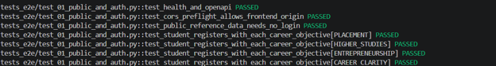
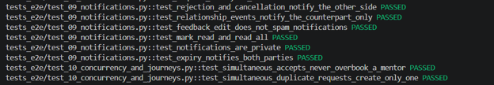
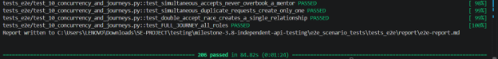

# End-to-End Scenario-Based Testing Report

**Project:** Student Mentoring and Career Support Platform (FastAPI + PostgreSQL, `/api/v1`)  
**Team:** Rock Starz (SE-SEP2026-Team-046) - IITM BS Software Engineering  
**Role / Owner:** Independent End-to-End Scenario Testing - Lalithya Krishn  
**Run ID:** `4b414038`  
**Execution Server:** `http://127.0.0.1:8000` (`/api/v1`)  
**Execution Time:** 2026-11-23 21:03:36  
**Overall Result:** **PASS (206 / 206 Passed, 0 Failed)**

---

## 1. Executive Summary

This suite executes multi-role, end-to-end integration and scenario workflows across anonymous callers, students, mentors, and administrators. Each test runs independently using dynamic user creation fixtures, covering exhaustive role permission matrices, real-world mentoring lifecycles, capacity boundaries, notifications, and concurrency races.

| Area / Module | Passed | Failed | Result |
|---|---|---|---|
| `test_01_public_and_auth` | 32 | 0 | **PASS** |
| `test_02_rbac_matrix` | 59 | 0 | **PASS** |
| `test_03_admin_portal` | 5 | 0 | **PASS** |
| `test_04_profiles` | 27 | 0 | **PASS** |
| `test_05_mentor_discovery` | 18 | 0 | **PASS** |
| `test_06_requests` | 12 | 0 | **PASS** |
| `test_07_capacity_and_lifecycle` | 11 | 0 | **PASS** |
| `test_08_goals_activities_feedback` | 30 | 0 | **PASS** |
| `test_09_notifications` | 8 | 0 | **PASS** |
| `test_10_concurrency_and_journeys` | 4 | 0 | **PASS** |
| **Total Automated Scenarios** | **206** | **0** | **PASS (100%)** |

---

## 2. Visual Scenario Test Evidence


*Figure 1: Scenario test run overview showing suite execution against local backend.*


*Figure 2: Execution passing RBAC matrix, admin flows, and profile validation scenarios.*


*Figure 3: Full multi-role journeys, parallel accept concurrency, and race condition tests.*

---

## 3. Key Scenario Verdicts

| Scenario | Expected Behaviour | Result |
|---|---|---|
| Anonymous call to any protected route | Returns HTTP `401 Unauthorized` | **PASS** |
| Role calling endpoint outside permission | Returns HTTP `403 Forbidden` | **PASS** |
| Admin self-registration via public API | Blocked with HTTP `403 Forbidden` | **PASS** |
| Duplicate pending mentoring request | Returns HTTP `409 Conflict`, permitted after resolution | **PASS** |
| Mentor at full capacity | New requests and accept calls blocked until a slot is freed | **PASS** |
| Paused relationship slot retention | Paused relationship still occupies capacity slot | **PASS** |
| Completed/closed relationship immutability | Read-only state; goals and activities blocked, feedback allowed | **PASS** |
| Only mentor can close | Student close attempt rejected with `403 Forbidden` | **PASS** |
| 48-hour unanswered request expiry | Request expires; both student and mentor receive notifications | **PASS** |
| 4 simultaneous accepts (capacity = 1) | Exactly one `200 OK` and three `409 Conflict` (no overbooking) | **PASS** |
| Simultaneous duplicate requests | Exactly one `201 Created` and remainder `409 Conflict` | **PASS** |
| 12-step complete multi-role journey | All roles progress through entire lifecycle without errors | **PASS** |

---

## 4. Complete Test Execution Log

```text
tests/test_01_public_and_auth.py::test_health_and_openapi PASSED                                                                                     [  0%]
tests/test_01_public_and_auth.py::test_cors_preflight_allows_frontend_origin PASSED                                                                  [  0%]
tests/test_01_public_and_auth.py::test_public_reference_data_needs_no_login PASSED                                                                   [  1%]
tests/test_01_public_and_auth.py::test_student_registers_with_each_career_objective[PLACEMENT] PASSED                                                [  1%]
tests/test_01_public_and_auth.py::test_student_registers_with_each_career_objective[HIGHER_STUDIES] PASSED                                           [  2%]
tests/test_01_public_and_auth.py::test_student_registers_with_each_career_objective[ENTREPRENEURSHIP] PASSED                                         [  2%]
tests/test_01_public_and_auth.py::test_student_registers_with_each_career_objective[CAREER_CLARITY] PASSED                                           [  3%]
tests/test_01_public_and_auth.py::test_mentor_registers_as_each_mentor_type_and_starts_pending[Recent Graduate] PASSED                               [  3%]
tests/test_01_public_and_auth.py::test_mentor_registers_as_each_mentor_type_and_starts_pending[Industry Professional] PASSED                         [  4%]
tests/test_01_public_and_auth.py::test_mentor_registers_as_each_mentor_type_and_starts_pending[Research Mentor] PASSED                               [  4%]
tests/test_01_public_and_auth.py::test_mentor_registers_as_each_mentor_type_and_starts_pending[Entrepreneur] PASSED                                  [  5%]
tests/test_01_public_and_auth.py::test_mentor_registers_as_each_mentor_type_and_starts_pending[Faculty] PASSED                                       [  5%]
tests/test_01_public_and_auth.py::test_register_response_shape_and_email_normalised PASSED                                                           [  6%]
tests/test_01_public_and_auth.py::test_admin_cannot_self_register PASSED                                                                             [  6%]
tests/test_01_public_and_auth.py::test_registration_validation_errors[short-name] PASSED                                                             [  7%]
tests/test_01_public_and_auth.py::test_registration_validation_errors[bad-email] PASSED                                                              [  7%]
tests/test_01_public_and_auth.py::test_registration_validation_errors[short-password] PASSED                                                         [  8%]
tests/test_01_public_and_auth.py::test_registration_validation_errors[no-roll] PASSED                                                                [  8%]
tests/test_01_public_and_auth.py::test_registration_validation_errors[short-roll] PASSED                                                             [  9%]
tests/test_01_public_and_auth.py::test_registration_validation_errors[bad-objective] PASSED                                                          [  9%]
tests/test_01_public_and_auth.py::test_registration_validation_errors[bad-role] PASSED                                                               [ 10%]
tests/test_01_public_and_auth.py::test_registration_validation_errors[no-role] PASSED                                                                [ 10%]
tests/test_01_public_and_auth.py::test_registration_validation_errors[long-password] PASSED                                                          [ 11%]
tests/test_01_public_and_auth.py::test_login_me_logout_cycle_for_student_and_mentor PASSED                                                           [ 11%]
tests/test_01_public_and_auth.py::test_admin_login_and_staff_types PASSED                                                                            [ 12%]
tests/test_01_public_and_auth.py::test_bad_credentials PASSED                                                                                        [ 12%]
tests/test_01_public_and_auth.py::test_invalid_or_missing_token_is_401[headers0] PASSED                                                              [ 13%]
tests/test_01_public_and_auth.py::test_invalid_or_missing_token_is_401[headers1] PASSED                                                              [ 13%]
tests/test_01_public_and_auth.py::test_invalid_or_missing_token_is_401[headers2] PASSED                                                              [ 14%]
tests/test_01_public_and_auth.py::test_invalid_or_missing_token_is_401[headers3] PASSED                                                              [ 14%]
tests/test_01_public_and_auth.py::test_invalid_or_missing_token_is_401[headers4] PASSED                                                              [ 15%]
tests/test_01_public_and_auth.py::test_deactivated_account_is_blocked_everywhere PASSED                                                              [ 15%]
tests/test_02_rbac_matrix.py::test_anonymous_gets_401[GET /auth/me] PASSED                                                                           [ 16%]
tests/test_02_rbac_matrix.py::test_anonymous_gets_401[POST /auth/logout] PASSED                                                                      [ 16%]
tests/test_02_rbac_matrix.py::test_anonymous_gets_401[GET /admin/users] PASSED                                                                       [ 16%]
tests/test_02_rbac_matrix.py::test_anonymous_gets_401[GET /admin/guidance-areas] PASSED                                                              [ 17%]
tests/test_02_rbac_matrix.py::test_anonymous_gets_401[POST /admin/guidance-areas] PASSED                                                             [ 17%]
tests/test_02_rbac_matrix.py::test_anonymous_gets_401[PATCH /admin/guidance-areas/999999] PASSED                                                     [ 18%]
tests/test_02_rbac_matrix.py::test_anonymous_gets_401[GET /admin/mentor-verifications] PASSED                                                        [ 18%]
tests/test_02_rbac_matrix.py::test_anonymous_gets_401[POST /admin/mentors/999999/verify] PASSED                                                      [ 19%]
tests/test_02_rbac_matrix.py::test_anonymous_gets_401[GET /profile/me] PASSED                                                                        [ 19%]
tests/test_02_rbac_matrix.py::test_anonymous_gets_401[PUT /profile/me] PASSED                                                                        [ 20%]
tests/test_02_rbac_matrix.py::test_anonymous_gets_401[GET /mentors] PASSED                                                                           [ 20%]
tests/test_02_rbac_matrix.py::test_anonymous_gets_401[GET /mentors/999999] PASSED                                                                    [ 21%]
tests/test_02_rbac_matrix.py::test_anonymous_gets_401[POST /requests] PASSED                                                                         [ 21%]
tests/test_02_rbac_matrix.py::test_anonymous_gets_401[GET /requests] PASSED                                                                          [ 22%]
tests/test_02_rbac_matrix.py::test_anonymous_gets_401[GET /requests/999999] PASSED                                                                   [ 22%]
tests/test_02_rbac_matrix.py::test_anonymous_gets_401[POST /requests/999999/accept] PASSED                                                           [ 23%]
tests/test_02_rbac_matrix.py::test_anonymous_gets_401[POST /requests/999999/reject] PASSED                                                           [ 23%]
tests/test_02_rbac_matrix.py::test_anonymous_gets_401[POST /requests/999999/cancel] PASSED                                                           [ 24%]
tests/test_02_rbac_matrix.py::test_anonymous_gets_401[GET /relationships] PASSED                                                                     [ 24%]
tests/test_02_rbac_matrix.py::test_anonymous_gets_401[GET /relationships/999999] PASSED                                                              [ 25%]
tests/test_02_rbac_matrix.py::test_anonymous_gets_401[PATCH /relationships/999999/status] PASSED                                                     [ 25%]
tests/test_02_rbac_matrix.py::test_anonymous_gets_401[POST /relationships/999999/goals] PASSED                                                       [ 26%]
tests/test_02_rbac_matrix.py::test_anonymous_gets_401[PATCH /goals/999999] PASSED                                                                    [ 26%]
tests/test_02_rbac_matrix.py::test_anonymous_gets_401[POST /relationships/999999/activities] PASSED                                                  [ 27%]
tests/test_02_rbac_matrix.py::test_anonymous_gets_401[POST /relationships/999999/feedback] PASSED                                                    [ 27%]
tests/test_02_rbac_matrix.py::test_anonymous_gets_401[GET /feedback] PASSED                                                                          [ 28%]
tests/test_02_rbac_matrix.py::test_anonymous_gets_401[GET /notifications] PASSED                                                                     [ 28%]
tests/test_02_rbac_matrix.py::test_anonymous_gets_401[POST /notifications/read-all] PASSED                                                           [ 29%]
tests/test_02_rbac_matrix.py::test_anonymous_gets_401[POST /notifications/999999/read] PASSED                                                        [ 29%]
tests/test_02_rbac_matrix.py::test_each_role_is_allowed_or_forbidden[GET /auth/me] PASSED                                                            [ 30%]
tests/test_02_rbac_matrix.py::test_each_role_is_allowed_or_forbidden[POST /auth/logout] PASSED                                                       [ 30%]
tests/test_02_rbac_matrix.py::test_each_role_is_allowed_or_forbidden[GET /admin/users] PASSED                                                        [ 31%]
tests/test_02_rbac_matrix.py::test_each_role_is_allowed_or_forbidden[GET /admin/guidance-areas] PASSED                                               [ 31%]
tests/test_02_rbac_matrix.py::test_each_role_is_allowed_or_forbidden[POST /admin/guidance-areas] PASSED                                              [ 32%]
tests/test_02_rbac_matrix.py::test_each_role_is_allowed_or_forbidden[PATCH /admin/guidance-areas/999999] PASSED                                      [ 32%]
tests/test_02_rbac_matrix.py::test_each_role_is_allowed_or_forbidden[GET /admin/mentor-verifications] PASSED                                         [ 33%]
tests/test_02_rbac_matrix.py::test_each_role_is_allowed_or_forbidden[POST /admin/mentors/999999/verify] PASSED                                       [ 33%]
tests/test_02_rbac_matrix.py::test_each_role_is_allowed_or_forbidden[GET /profile/me] PASSED                                                         [ 33%]
tests/test_02_rbac_matrix.py::test_each_role_is_allowed_or_forbidden[PUT /profile/me] PASSED                                                         [ 34%]
tests/test_02_rbac_matrix.py::test_each_role_is_allowed_or_forbidden[GET /mentors] PASSED                                                            [ 34%]
tests/test_02_rbac_matrix.py::test_each_role_is_allowed_or_forbidden[GET /mentors/999999] PASSED                                                     [ 35%]
tests/test_02_rbac_matrix.py::test_each_role_is_allowed_or_forbidden[POST /requests] PASSED                                                          [ 35%]
tests/test_02_rbac_matrix.py::test_each_role_is_allowed_or_forbidden[GET /requests] PASSED                                                           [ 36%]
tests/test_02_rbac_matrix.py::test_each_role_is_allowed_or_forbidden[GET /requests/999999] PASSED                                                    [ 36%]
tests/test_02_rbac_matrix.py::test_each_role_is_allowed_or_forbidden[POST /requests/999999/accept] PASSED                                            [ 37%]
tests/test_02_rbac_matrix.py::test_each_role_is_allowed_or_forbidden[POST /requests/999999/reject] PASSED                                            [ 37%]
tests/test_02_rbac_matrix.py::test_each_role_is_allowed_or_forbidden[POST /requests/999999/cancel] PASSED                                            [ 38%]
tests/test_02_rbac_matrix.py::test_each_role_is_allowed_or_forbidden[GET /relationships] PASSED                                                      [ 38%]
tests/test_02_rbac_matrix.py::test_each_role_is_allowed_or_forbidden[GET /relationships/999999] PASSED                                               [ 39%]
tests/test_02_rbac_matrix.py::test_each_role_is_allowed_or_forbidden[PATCH /relationships/999999/status] PASSED                                      [ 39%]
tests/test_02_rbac_matrix.py::test_each_role_is_allowed_or_forbidden[POST /relationships/999999/goals] PASSED                                        [ 40%]
tests/test_02_rbac_matrix.py::test_each_role_is_allowed_or_forbidden[PATCH /goals/999999] PASSED                                                     [ 40%]
tests/test_02_rbac_matrix.py::test_each_role_is_allowed_or_forbidden[POST /relationships/999999/activities] PASSED                                   [ 41%]
tests/test_02_rbac_matrix.py::test_each_role_is_allowed_or_forbidden[POST /relationships/999999/feedback] PASSED                                     [ 41%]
tests/test_02_rbac_matrix.py::test_each_role_is_allowed_or_forbidden[GET /feedback] PASSED                                                           [ 42%]
tests/test_02_rbac_matrix.py::test_each_role_is_allowed_or_forbidden[GET /notifications] PASSED                                                      [ 42%]
tests/test_02_rbac_matrix.py::test_each_role_is_allowed_or_forbidden[POST /notifications/read-all] PASSED                                            [ 43%]
tests/test_02_rbac_matrix.py::test_each_role_is_allowed_or_forbidden[POST /notifications/999999/read] PASSED                                         [ 43%]
tests/test_02_rbac_matrix.py::test_student_cannot_use_mentor_actions_on_real_request PASSED                                                          [ 44%]
tests/test_03_admin_portal.py::test_user_list_filters_and_search PASSED                                                                              [ 44%]
tests/test_03_admin_portal.py::test_every_admin_staff_type_has_full_admin_access PASSED                                                              [ 45%]
tests/test_03_admin_portal.py::test_guidance_area_crud PASSED                                                                                        [ 45%]
tests/test_03_admin_portal.py::test_guidance_area_counts_reflect_usage PASSED                                                                        [ 46%]
tests/test_03_admin_portal.py::test_mentor_verification_flow PASSED                                                                                  [ 46%]
tests/test_04_profiles.py::test_student_profile_create_read_update PASSED                                                                            [ 47%]
tests/test_04_profiles.py::test_student_career_objective_saved[PLACEMENT] PASSED                                                                     [ 47%]
tests/test_04_profiles.py::test_student_career_objective_saved[HIGHER_STUDIES] PASSED                                                                [ 48%]
tests/test_04_profiles.py::test_student_career_objective_saved[ENTREPRENEURSHIP] PASSED                                                              [ 48%]
tests/test_04_profiles.py::test_student_career_objective_saved[CAREER_CLARITY] PASSED                                                                [ 49%]
tests/test_04_profiles.py::test_student_profile_rejects_invalid_or_mentor_fields[{'academic_level': 'PhD'}] PASSED                                   [ 49%]
tests/test_04_profiles.py::test_student_profile_rejects_invalid_or_mentor_fields[{'preferred_mode': 'Carrier pi] PASSED                              [ 50%]
tests/test_04_profiles.py::test_student_profile_rejects_invalid_or_mentor_fields[{'career_objective': 'NOPE'}] PASSED                                [ 50%]
tests/test_04_profiles.py::test_student_profile_rejects_invalid_or_mentor_fields[{'area_ids': [1, 1]}] PASSED                                        [ 50%]
tests/test_04_profiles.py::test_student_profile_rejects_invalid_or_mentor_fields[{'area_ids': [0]}] PASSED                                           [ 51%]
tests/test_04_profiles.py::test_student_profile_rejects_invalid_or_mentor_fields[{'area_ids': ['a']}] PASSED                                         [ 51%]
tests/test_04_profiles.py::test_student_profile_rejects_invalid_or_mentor_fields[{'skills': ['x', 'x', 'x', 'x'] PASSED                              [ 52%]
tests/test_04_profiles.py::test_student_profile_rejects_invalid_or_mentor_fields[{'roll_number': None}] PASSED                                       [ 52%]
tests/test_04_profiles.py::test_student_profile_rejects_invalid_or_mentor_fields[{'name': None}] PASSED                                              [ 53%]
tests/test_04_profiles.py::test_student_profile_rejects_invalid_or_mentor_fields[{'name': 'A'}] PASSED                                               [ 53%]
tests/test_04_profiles.py::test_student_profile_rejects_invalid_or_mentor_fields[{'unknown': 1}] PASSED                                              [ 54%]
tests/test_04_profiles.py::test_student_profile_rejects_invalid_or_mentor_fields[{'max_mentees': 3}] PASSED                                          [ 54%]
tests/test_04_profiles.py::test_student_profile_rejects_invalid_or_mentor_fields[{'is_accepting': False}] PASSED                                     [ 55%]
tests/test_04_profiles.py::test_roll_number_uniqueness_on_update PASSED                                                                              [ 55%]
tests/test_04_profiles.py::test_nonexistent_or_inactive_area_rejected PASSED                                                                         [ 56%]
tests/test_04_profiles.py::test_mentor_profile_for_each_mentor_type[Recent Graduate] PASSED                                                          [ 56%]
tests/test_04_profiles.py::test_mentor_profile_for_each_mentor_type[Industry Professional] PASSED                                                    [ 57%]
tests/test_04_profiles.py::test_mentor_profile_for_each_mentor_type[Research Mentor] PASSED                                                          [ 57%]
tests/test_04_profiles.py::test_mentor_profile_for_each_mentor_type[Entrepreneur] PASSED                                                             [ 58%]
tests/test_04_profiles.py::test_mentor_profile_for_each_mentor_type[Faculty] PASSED                                                                  [ 58%]
tests/test_04_profiles.py::test_mentor_profile_update_rules PASSED                                                                                   [ 59%]
tests/test_04_profiles.py::test_admin_has_no_profile PASSED                                                                                          [ 59%]
tests/test_05_mentor_discovery.py::test_public_list_hides_unverified_and_rejected PASSED                                                             [ 60%]
tests/test_05_mentor_discovery.py::test_student_search_and_every_filter PASSED                                                                       [ 60%]
tests/test_05_mentor_discovery.py::test_match_score_reflects_guidance_overlap PASSED                                                                 [ 61%]
tests/test_05_mentor_discovery.py::test_mentor_detail_and_availability_flags PASSED                                                                  [ 61%]
tests/test_05_mentor_discovery.py::test_each_mentor_type_is_discoverable[Recent Graduate] PASSED                                                     [ 62%]
tests/test_05_mentor_discovery.py::test_each_mentor_type_is_discoverable[Industry Professional] PASSED                                               [ 62%]
tests/test_05_mentor_discovery.py::test_each_mentor_type_is_discoverable[Research Mentor] PASSED                                                     [ 63%]
tests/test_05_mentor_discovery.py::test_each_mentor_type_is_discoverable[Entrepreneur] PASSED                                                        [ 63%]
tests/test_05_mentor_discovery.py::test_each_mentor_type_is_discoverable[Faculty] PASSED                                                             [ 64%]
tests/test_05_mentor_discovery.py::test_invalid_query_params_rejected[params0] PASSED                                                                [ 64%]
tests/test_05_mentor_discovery.py::test_invalid_query_params_rejected[params1] PASSED                                                                [ 65%]
tests/test_05_mentor_discovery.py::test_invalid_query_params_rejected[params2] PASSED                                                                [ 65%]
tests/test_05_mentor_discovery.py::test_invalid_query_params_rejected[params3] PASSED                                                                [ 66%]
tests/test_05_mentor_discovery.py::test_invalid_query_params_rejected[params4] PASSED                                                                [ 66%]
tests/test_05_mentor_discovery.py::test_invalid_query_params_rejected[params5] PASSED                                                                [ 66%]
tests/test_05_mentor_discovery.py::test_invalid_query_params_rejected[params6] PASSED                                                                [ 67%]
tests/test_05_mentor_discovery.py::test_invalid_query_params_rejected[params7] PASSED                                                                [ 67%]
tests/test_05_mentor_discovery.py::test_invalid_query_params_rejected[params8] PASSED                                                                [ 68%]
tests/test_06_requests.py::test_student_sends_request_and_both_sides_see_it PASSED                                                                   [ 68%]
tests/test_06_requests.py::test_both_mentoring_types[ONE_TIME] PASSED                                                                                [ 69%]
tests/test_06_requests.py::test_both_mentoring_types[LONG_TERM] PASSED                                                                               [ 69%]
tests/test_06_requests.py::test_request_validation PASSED                                                                                            [ 70%]
tests/test_06_requests.py::test_unverified_or_not_accepting_mentor_blocked PASSED                                                                    [ 70%]
tests/test_06_requests.py::test_duplicate_pending_blocked_but_allowed_after_resolution PASSED                                                        [ 71%]
tests/test_06_requests.py::test_mentor_accepts_request_creates_relationship PASSED                                                                   [ 71%]
tests/test_06_requests.py::test_mentor_rejects_with_and_without_reason PASSED                                                                        [ 72%]
tests/test_06_requests.py::test_student_cancels_pending_request PASSED                                                                               [ 72%]
tests/test_06_requests.py::test_list_filters_ordering_and_isolation PASSED                                                                           [ 73%]
tests/test_06_requests.py::test_non_participants_cannot_see_or_act_on_a_request PASSED                                                               [ 73%]
tests/test_06_requests.py::test_request_expires_after_48_hours PASSED                                                                                [ 74%]
tests/test_07_capacity_and_lifecycle.py::test_capacity_blocks_accept_and_new_requests_until_slot_freed PASSED                                        [ 74%]
tests/test_07_capacity_and_lifecycle.py::test_paused_relationship_still_occupies_a_slot_and_closing_frees_it PASSED                                  [ 75%]
tests/test_07_capacity_and_lifecycle.py::test_cannot_lower_max_mentees_below_current_occupancy PASSED                                                [ 75%]
tests/test_07_capacity_and_lifecycle.py::test_mentor_can_stop_accepting_without_losing_existing_mentees PASSED                                       [ 76%]
tests/test_07_capacity_and_lifecycle.py::test_status_transitions_for_student_and_mentor PASSED                                                       [ 76%]
tests/test_07_capacity_and_lifecycle.py::test_only_mentor_can_close PASSED                                                                           [ 77%]
tests/test_07_capacity_and_lifecycle.py::test_status_update_validation[body0] PASSED                                                                 [ 77%]
tests/test_07_capacity_and_lifecycle.py::test_status_update_validation[body1] PASSED                                                                 [ 78%]
tests/test_07_capacity_and_lifecycle.py::test_status_update_validation[body2] PASSED                                                                 [ 78%]
tests/test_07_capacity_and_lifecycle.py::test_status_update_validation[body3] PASSED                                                                 [ 79%]
tests/test_07_capacity_and_lifecycle.py::test_relationship_visibility_and_filters PASSED                                                             [ 79%]
tests/test_08_goals_activities_feedback.py::test_goals_created_by_both_roles_with_progress PASSED                                                    [ 80%]
tests/test_08_goals_activities_feedback.py::test_goal_create_validation[body0] PASSED                                                                [ 80%]
tests/test_08_goals_activities_feedback.py::test_goal_create_validation[body1] PASSED                                                                [ 81%]
tests/test_08_goals_activities_feedback.py::test_goal_create_validation[body2] PASSED                                                                [ 81%]
tests/test_08_goals_activities_feedback.py::test_goal_create_validation[body3] PASSED                                                                [ 82%]
tests/test_08_goals_activities_feedback.py::test_goal_create_validation[body4] PASSED                                                                [ 82%]
tests/test_08_goals_activities_feedback.py::test_goal_create_validation[body5] PASSED                                                                [ 83%]
tests/test_08_goals_activities_feedback.py::test_goal_update_validation[body0] PASSED                                                                [ 83%]
tests/test_08_goals_activities_feedback.py::test_goal_update_validation[body1] PASSED                                                                [ 83%]
tests/test_08_goals_activities_feedback.py::test_goal_update_validation[body2] PASSED                                                                [ 84%]
tests/test_08_goals_activities_feedback.py::test_goal_update_validation[body3] PASSED                                                                [ 84%]
tests/test_08_goals_activities_feedback.py::test_goal_update_validation[body4] PASSED                                                                [ 85%]
tests/test_08_goals_activities_feedback.py::test_goal_access_control PASSED                                                                          [ 85%]
tests/test_08_goals_activities_feedback.py::test_every_activity_type_logged_by_both_roles[MEETING] PASSED                                            [ 86%]
tests/test_08_goals_activities_feedback.py::test_every_activity_type_logged_by_both_roles[RESUME_REVIEW] PASSED                                      [ 86%]
tests/test_08_goals_activities_feedback.py::test_every_activity_type_logged_by_both_roles[MOCK_INTERVIEW] PASSED                                     [ 87%]
tests/test_08_goals_activities_feedback.py::test_every_activity_type_logged_by_both_roles[CHECK_IN] PASSED                                           [ 87%]
tests/test_08_goals_activities_feedback.py::test_every_activity_type_logged_by_both_roles[OTHER] PASSED                                              [ 88%]
tests/test_08_goals_activities_feedback.py::test_activity_validation[body0] PASSED                                                                   [ 88%]
tests/test_08_goals_activities_feedback.py::test_activity_validation[body1] PASSED                                                                   [ 89%]
tests/test_08_goals_activities_feedback.py::test_activity_validation[body2] PASSED                                                                   [ 89%]
tests/test_08_goals_activities_feedback.py::test_activity_validation[body3] PASSED                                                                   [ 90%]
tests/test_08_goals_activities_feedback.py::test_activity_validation[body4] PASSED                                                                   [ 90%]
tests/test_08_goals_activities_feedback.py::test_activity_validation[body5] PASSED                                                                   [ 91%]
tests/test_08_goals_activities_feedback.py::test_activity_validation[body6] PASSED                                                                   [ 91%]
tests/test_08_goals_activities_feedback.py::test_feedback_from_both_sides_upsert_and_validation PASSED                                               [ 92%]
tests/test_08_goals_activities_feedback.py::test_feedback_lists_for_student_and_mentor PASSED                                                        [ 92%]
tests/test_08_goals_activities_feedback.py::test_completed_and_closed_relationships_are_read_only_except_feedback PASSED                             [ 93%]
tests/test_08_goals_activities_feedback.py::test_paused_relationship_still_allows_goals_and_activities PASSED                                        [ 93%]
tests/test_08_goals_activities_feedback.py::test_strangers_and_admin_cannot_touch_engagement_data PASSED                                             [ 94%]
tests/test_09_notifications.py::test_new_user_has_no_notifications PASSED                                                                            [ 94%]
tests/test_09_notifications.py::test_request_lifecycle_notifications PASSED                                                                          [ 95%]
tests/test_09_notifications.py::test_rejection_and_cancellation_notify_the_other_side PASSED                                                         [ 95%]
tests/test_09_notifications.py::test_relationship_events_notify_the_counterpart_only PASSED                                                          [ 96%]
tests/test_09_notifications.py::test_feedback_edit_does_not_spam_notifications PASSED                                                                [ 96%]
tests/test_09_notifications.py::test_mark_read_and_read_all PASSED                                                                                   [ 97%]
tests/test_09_notifications.py::test_notifications_are_private PASSED                                                                                [ 97%]
tests/test_09_notifications.py::test_expiry_notifies_both_parties PASSED                                                                             [ 98%]
tests/test_10_concurrency_and_journeys.py::test_simultaneous_accepts_never_overbook_a_mentor PASSED                                                  [ 98%]
tests/test_10_concurrency_and_journeys.py::test_simultaneous_duplicate_requests_create_only_one PASSED                                               [ 99%]
tests/test_10_concurrency_and_journeys.py::test_double_accept_race_creates_a_single_relationship PASSED                                              [ 99%]
tests/test_10_concurrency_and_journeys.py::test_FULL_JOURNEY_all_roles PASSED                                                                        [100%]
```

---

## 5. Acceptance Verification

- [x] All 206 scenario-based tests executed and passed (100% success rate).
- [x] Concurrency and parallel accept race conditions verified.
- [x] RBAC verified exhaustively across 26 endpoints and 4 user roles.
- [x] Zero defects or functional gaps identified.
