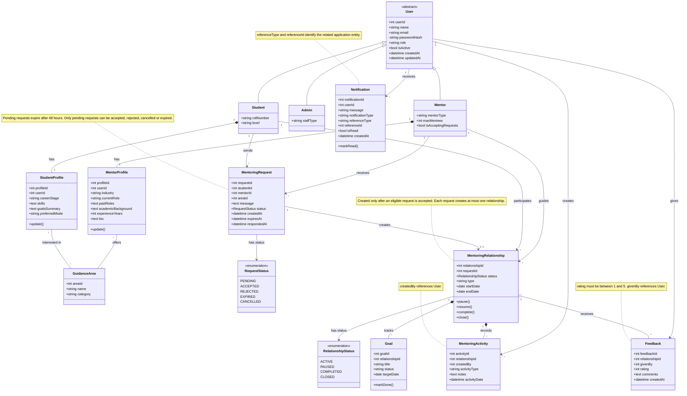

# UML Class Diagram – Rock Starz

## 1. Introduction

The Rock Starz platform is a web-based student mentoring and career guidance system that connects students with suitable mentors and supports the management of mentoring requests, relationships, goals, activities and feedback.

The UML Class Diagram represents the static structure of the platform. It identifies the major classes, their attributes, operations, relationships and associations.

The diagram follows an object-oriented modelling approach, with a common abstract User class extended by Student, Mentor and Admin classes. Additional classes represent the different entities and activities involved in the mentoring process.

The class diagram serves as a design reference for implementing the platform's backend models, business logic and database relationships.

## 2. UML Class Diagram

The following diagram illustrates the major classes and their relationships within the Rock Starz platform.

The diagram is organized around the following functional areas:

1. User management and role specialization.
2. Student and mentor profile management.
3. Guidance area classification.
4. Mentoring request management.
5. Mentoring relationship management.
6. Goal and activity tracking.
7. Feedback management.
8. Notification management.

## 3. Class Descriptions

### 3.1 User Management Classes

#### 3.1.1 User

**Type:** Abstract Class

The User class is the common base class for all users of the platform. It contains the attributes shared by students, mentors and administrators.

**Attributes:**

| Attribute | Data Type | Description |
|---|---|---|
| userId | int | Unique identifier for a user. |
| name | string | Full name of the user. |
| email | string | Email address used for user identification and communication. |
| passwordHash | string | Hashed representation of the user's password. |
| role | string | Role assigned to the user. |
| isActive | bool | Indicates whether the user account is active. |
| createdAt | datetime | Date and time when the account was created. |
| updatedAt | datetime | Date and time when the account was last updated. |

The passwordHash attribute is private, as indicated by the minus (-) visibility symbol in the diagram. Other attributes are public, as indicated by the plus (+) symbol.

The User class is abstract and is not intended to represent a standalone user type in the class hierarchy.

#### 3.1.2 Student

The Student class extends the User class and represents students registered on the platform.

**Attributes:**

| Attribute | Data Type | Description |
|---|---|---|
| rollNumber | string | Student's institutional roll number. |
| level | string | Student's academic level. |

A student can maintain a student profile, identify relevant guidance areas, send mentoring requests and participate in mentoring relationships.

#### 3.1.3 Mentor

The Mentor class extends the User class and represents individuals who provide mentoring and career guidance.

**Attributes:**

| Attribute | Data Type | Description |
|---|---|---|
| mentorType | string | Category or type of mentor. |
| maxMentees | int | Maximum number of mentees the mentor can support. |
| isAcceptingRequests | bool | Indicates whether the mentor is currently accepting requests. |

A mentor can maintain a mentor profile, offer guidance in relevant areas, receive mentoring requests and guide students through mentoring relationships.

#### 3.1.4 Admin

The Admin class extends the User class and represents administrative users of the platform.

**Attributes:**

| Attribute | Data Type | Description |
|---|---|---|
| staffType | string | Type or category of administrative staff. |

Administrators support platform-level activities such as user management, monitoring and reporting.

### 3.2 Profile and Guidance Classes

#### 3.2.1 StudentProfile

The StudentProfile class stores additional information specific to a student.

**Attributes:**

| Attribute | Data Type | Description |
|---|---|---|
| profileId | int | Unique identifier for the student profile. |
| userId | int | Identifier of the associated student user. |
| careerStage | string | Student's current career stage. |
| skills | text | Skills and competencies possessed by the student. |
| goalsSummary | text | Summary of the student's career or mentoring goals. |
| preferredMode | string | Preferred mode of mentoring interaction. |

**Method:**

- `update()` – Updates the student's profile information.

This class separates student-specific profile information from the common attributes maintained in the User class.

#### 3.2.2 MentorProfile

The MentorProfile class stores professional and academic information about a mentor.

**Attributes:**

| Attribute | Data Type | Description |
|---|---|---|
| profileId | int | Unique identifier for the mentor profile. |
| userId | int | Identifier of the associated mentor user. |
| industry | string | Industry in which the mentor works or has experience. |
| currentRole | string | Mentor's current professional role. |
| pastRoles | text | Summary of previous professional roles. |
| academicBackground | text | Mentor's academic qualifications and background. |
| experienceYears | int | Total years of professional experience. |
| bio | text | Additional information describing the mentor. |

**Method:**

- `update()` – Updates the mentor's profile information.

The mentor profile provides information that can help students identify mentors whose expertise and experience match their requirements.

#### 3.2.3 GuidanceArea

The GuidanceArea class represents the different career, academic and professional guidance categories available on the platform.

**Attributes:**

| Attribute | Data Type | Description |
|---|---|---|
| areaId | int | Unique identifier for a guidance area. |
| name | string | Name of the guidance area. |
| category | string | Category to which the guidance area belongs. |

Students can express interest in multiple guidance areas, while mentors can offer guidance in multiple areas.

This supports matching students with mentors based on their interests and areas of expertise.

### 3.3 Mentoring Request Classes

#### 3.3.1 MentoringRequest

The MentoringRequest class represents a request initiated by a student to receive guidance from a mentor.

**Attributes:**

| Attribute | Data Type | Description |
|---|---|---|
| requestId | int | Unique identifier for the mentoring request. |
| studentId | int | Identifier of the student initiating the request. |
| mentorId | int | Identifier of the mentor receiving the request. |
| areaId | int | Identifier of the associated guidance area. |
| message | text | Message or explanation provided with the request. |
| status | RequestStatus | Current status of the mentoring request. |
| createdAt | datetime | Date and time when the request was created. |
| expiresAt | datetime | Date and time after which the pending request expires. |
| respondedAt | datetime | Date and time when the mentor responds to the request. |

The request class supports the lifecycle of mentoring requests, from creation to acceptance, rejection, cancellation or expiry.

#### 3.3.2 RequestStatus

**Type:** Enumeration

The RequestStatus enumeration defines the possible states of a mentoring request.

| Status | Description |
|---|---|
| PENDING | The request has been created and is awaiting a response. |
| ACCEPTED | The mentor has accepted the request. |
| REJECTED | The mentor has rejected the request. |
| EXPIRED | The request has expired because it remained pending beyond the permitted period. |
| CANCELLED | The request has been cancelled. |

**Business Rule:**

Pending mentoring requests expire after 48 hours. Only requests that are currently pending can be accepted, rejected, cancelled or expired.

This rule ensures that the platform does not retain unanswered mentoring requests indefinitely.

### 3.4 Mentoring Relationship Classes

#### 3.4.1 MentoringRelationship

The MentoringRelationship class represents an established mentoring relationship between a student and a mentor.

**Attributes:**

| Attribute | Data Type | Description |
|---|---|---|
| relationshipId | int | Unique identifier for the mentoring relationship. |
| requestId | int | Identifier of the mentoring request from which the relationship originated. |
| status | RelationshipStatus | Current status of the mentoring relationship. |
| type | string | Type or category of mentoring relationship. |
| startDate | date | Date on which the mentoring relationship begins. |
| endDate | date | Date on which the mentoring relationship ends. |

**Methods:**

| Method | Description |
|---|---|
| `pause()` | Temporarily pauses an active mentoring relationship. |
| `resume()` | Resumes a previously paused mentoring relationship. |
| `complete()` | Marks the mentoring relationship as completed. |
| `close()` | Closes the mentoring relationship. |

A mentoring relationship is created only after an eligible mentoring request is accepted. Each request can create at most one mentoring relationship.

The relationship acts as the central entity for tracking mentoring goals, activities and feedback.

#### 3.4.2 RelationshipStatus

**Type:** Enumeration

The RelationshipStatus enumeration defines the possible states of a mentoring relationship.

| Status | Description |
|---|---|
| ACTIVE | The mentoring relationship is currently active. |
| PAUSED | The mentoring relationship has been temporarily paused. |
| COMPLETED | The mentoring relationship has been completed. |
| CLOSED | The mentoring relationship has been closed. |

The status helps track the lifecycle of an established mentoring relationship.

### 3.5 Goal and Activity Management Classes

#### 3.5.1 Goal

The Goal class represents an objective defined as part of a mentoring relationship.

**Attributes:**

| Attribute | Data Type | Description |
|---|---|---|
| goalId | int | Unique identifier for the goal. |
| relationshipId | int | Identifier of the associated mentoring relationship. |
| title | string | Description or title of the goal. |
| status | string | Current completion status of the goal. |
| targetDate | date | Target date for achieving the goal. |

**Method:**

- `markDone()` – Marks the goal as completed.

Goals help students and mentors organize mentoring activities around specific objectives and track progress over time.

#### 3.5.2 MentoringActivity

The MentoringActivity class represents an activity recorded as part of a mentoring relationship.

**Attributes:**

| Attribute | Data Type | Description |
|---|---|---|
| activityId | int | Unique identifier for the activity. |
| relationshipId | int | Identifier of the associated mentoring relationship. |
| createdBy | int | Identifier of the user who created the activity. |
| activityType | string | Type or category of the activity. |
| notes | text | Additional information or notes about the activity. |
| activityDate | datetime | Date and time associated with the activity. |

Mentoring activities provide a record of interactions and progress within a mentoring relationship.

The createdBy attribute references the User class, allowing activities to be associated with the user who recorded them.

### 3.6 Feedback Management Class

#### 3.6.1 Feedback

The Feedback class represents feedback provided by a user in relation to a mentoring relationship.

**Attributes:**

| Attribute | Data Type | Description |
|---|---|---|
| feedbackId | int | Unique identifier for the feedback record. |
| relationshipId | int | Identifier of the associated mentoring relationship. |
| givenBy | int | Identifier of the user providing the feedback. |
| rating | int | Numerical rating assigned to the mentoring experience. |
| comments | text | Additional comments or observations. |
| createdAt | datetime | Date and time when the feedback was submitted. |

The givenBy attribute references the User class.

**Business Rule:**

The feedback rating must be between 1 and 5.

Feedback supports the evaluation of mentoring interactions and provides a mechanism for users to communicate their experiences.

### 3.7 Notification Management Class

#### 3.7.1 Notification

The Notification class represents a notification delivered to a platform user.

**Attributes:**

| Attribute | Data Type | Description |
|---|---|---|
| notificationId | int | Unique identifier for the notification. |
| userId | int | Identifier of the user receiving the notification. |
| message | string | Notification message displayed to the user. |
| notificationType | string | Type or category of notification. |
| referenceType | string | Type of application entity associated with the notification. |
| referenceId | int | Identifier of the related application entity. |
| isRead | bool | Indicates whether the notification has been read. |
| createdAt | datetime | Date and time when the notification was created. |

**Method:**

- `markRead()` – Marks the notification as read.

The referenceType and referenceId attributes identify the application entity associated with a notification. This allows notifications to refer to different types of application records.

## 4. Class Relationships

The diagram uses inheritance, composition, aggregation and association relationships to represent the structural connections between classes.

### 4.1 Inheritance

Inheritance represents an is-a relationship between a general class and its specialized classes.

The diagram defines the following inheritance relationships:

- Student extends User.
- Mentor extends User.
- Admin extends User.

The User class contains common user attributes, while the specialized classes contain attributes specific to each role.

This reduces duplication and establishes a shared structure for user management.

### 4.2 Composition

Composition represents a strong whole-part relationship in which the lifecycle of a contained object is associated with its owning object.

The diagram contains the following composition relationships:

**Student – StudentProfile**

- One Student has one StudentProfile.
- Each StudentProfile belongs to one Student in the model.

**Mentor – MentorProfile**

- One Mentor has one MentorProfile.
- Each MentorProfile belongs to one Mentor in the model.

**MentoringRelationship – Goal**

- One mentoring relationship can track multiple goals.
- Each goal belongs to one mentoring relationship.

**MentoringRelationship – MentoringActivity**

- One mentoring relationship can contain multiple activities.
- Each activity belongs to one mentoring relationship.

### 4.3 Aggregation

Aggregation represents a whole-part relationship in which the related objects can have independent lifecycles.

The diagram uses aggregation between MentoringRelationship and Feedback.

- One mentoring relationship can receive multiple feedback records.
- Each feedback record is associated with one mentoring relationship.

Feedback is modelled as an associated record rather than a composition-owned object.

### 4.4 Associations

Associations represent relationships between independent classes.

The diagram includes the following associations:

| Classes | Relationship | Multiplicity |
|---|---|---|
| StudentProfile – GuidanceArea | Students are interested in guidance areas. | Many-to-many |
| MentorProfile – GuidanceArea | Mentors offer guidance in different areas. | Many-to-many |
| Student – MentoringRequest | Students send mentoring requests. | One-to-many |
| Mentor – MentoringRequest | Mentors receive mentoring requests. | One-to-many |
| MentoringRequest – RequestStatus | A request has a status. | One-to-one reference to an enumeration |
| MentoringRequest – MentoringRelationship | An accepted request can create a relationship. | One-to-zero-or-one |
| Student – MentoringRelationship | Students participate in mentoring relationships. | One-to-many |
| Mentor – MentoringRelationship | Mentors guide students through relationships. | One-to-many |
| MentoringRelationship – RelationshipStatus | A relationship has a status. | One-to-one reference to an enumeration |
| User – MentoringActivity | Users create mentoring activities. | One-to-many |
| MentoringRelationship – Feedback | Relationships receive feedback. | One-to-many |
| User – Feedback | Users give feedback. | One-to-many |
| User – Notification | Users receive notifications. | One-to-many |

The many-to-many guidance-area associations allow students and mentors to be connected with multiple guidance categories.

### 4.5 Multiplicity

Multiplicity indicates the number of objects that can participate in a relationship.

The diagram uses the following multiplicities:

| Multiplicity | Meaning |
|---|---|
| 1 | Exactly one object. |
| * | Zero or more objects. |
| 0..1 | Zero or one object. |

Examples:

- One student can send multiple mentoring requests.
- One mentor can receive multiple mentoring requests.
- One mentoring request can create zero or one mentoring relationship.
- One mentoring relationship can track multiple goals and activities.
- One user can receive multiple notifications.

## 5. Major Class Interaction Workflows

### 5.1 User Registration and Profile Management

1. A user is represented by the User class.
2. The user's role determines whether the user is represented as a Student, Mentor or Admin.
3. Students maintain additional information through StudentProfile.
4. Mentors maintain professional information through MentorProfile.
5. Profile information can be updated using the respective update() operation.

### 5.2 Guidance Area Selection

1. GuidanceArea stores the available guidance categories.
2. StudentProfile represents the guidance areas in which a student is interested.
3. MentorProfile represents the guidance areas offered by a mentor.
4. The many-to-many associations allow multiple interests and expertise areas.
5. These associations support the platform's mentor discovery and matching functionality.

### 5.3 Mentoring Request Lifecycle

1. A student identifies a suitable mentor.
2. A MentoringRequest is created with the relevant student, mentor and guidance area identifiers.
3. The request initially has the PENDING status.
4. The mentor receives and responds to the request.
5. The request can transition to ACCEPTED or REJECTED.
6. A pending request can also be CANCELLED or EXPIRED.
7. Pending requests expire after 48 hours according to the business rule represented in the diagram.

### 5.4 Mentoring Relationship Lifecycle

1. An eligible accepted request creates a MentoringRelationship.
2. The relationship is associated with the originating request.
3. The relationship begins with an appropriate status.
4. The relationship can be paused, resumed, completed or closed.
5. Goals and activities are maintained against the relationship.
6. Feedback can be associated with the relationship.

The one-to-zero-or-one association between MentoringRequest and MentoringRelationship prevents a single request from creating multiple relationships in the model.

### 5.5 Goal and Activity Tracking

1. A mentoring relationship can have multiple goals.
2. Each goal contains a title, status and target date.
3. The markDone() method marks a goal as completed.
4. Activities can be recorded throughout the mentoring relationship.
5. Each activity records its type, notes, date and creating user.

This supports the monitoring of mentoring progress and activities.

### 5.6 Feedback and Notification Management

**Feedback:**

1. A user provides feedback about a mentoring relationship.
2. A feedback record stores the relationship identifier and user identifier.
3. A numerical rating and optional comments are recorded.
4. The rating must remain within the defined range of 1 to 5.

**Notifications:**

1. A notification is associated with a recipient through userId.
2. Its message and notification type describe the event.
3. referenceType and referenceId identify the related application entity.
4. The isRead attribute tracks whether the notification has been read.
5. The markRead() method updates the read status.

## 6. Mapping to the Component Architecture

The UML classes correspond to the functional responsibilities identified in the M2.2 component architecture.

| Component / Service | Related Classes |
|---|---|
| Profile Service | User, Student, Mentor, Admin, StudentProfile, MentorProfile |
| Discovery and Matching Service | StudentProfile, MentorProfile, GuidanceArea |
| Request Service | MentoringRequest, RequestStatus |
| Relationship Service | MentoringRelationship, RelationshipStatus, Goal, MentoringActivity |
| Feedback Service | Feedback |
| Notification Service | Notification |
| Reporting Service | User, MentoringRequest, MentoringRelationship, Goal, MentoringActivity, Feedback |

This mapping illustrates how the object model supports the responsibilities of the backend application services.

## 7. Design Considerations and Business Rules

The class diagram incorporates several design considerations relevant to the Rock Starz platform.

### 7.1 Common User Representation

The abstract User class provides a shared structure for students, mentors and administrators. Role-specific classes extend the common structure without duplicating common user attributes.

### 7.2 Profile Separation

StudentProfile and MentorProfile separate role-specific information from common account information. This allows profile data to evolve independently of the shared User attributes.

### 7.3 Flexible Guidance Classification

GuidanceArea supports multiple student interests and mentor expertise areas through many-to-many associations. This provides flexibility when matching students with mentors.

### 7.4 Controlled Request Lifecycle

The RequestStatus enumeration defines the permitted request states. The 48-hour expiry rule prevents pending requests from remaining unanswered indefinitely.

### 7.5 Controlled Relationship Creation

A MentoringRelationship is created only after an eligible request is accepted. The model allows at most one relationship for each request.

### 7.6 Mentoring Progress Tracking

Goals and activities are associated with mentoring relationships, providing a structured way to monitor mentoring progress.

### 7.7 Feedback Validation

Feedback ratings are restricted to values between 1 and 5. The model also associates feedback with both a mentoring relationship and the user who provided it.

### 7.8 Flexible Notification References

The referenceType and referenceId attributes allow notifications to refer to different application entities without introducing a separate relationship for every possible notification target.

## 8. Database Mapping and Implementation Considerations

The class diagram provides an object-oriented view of the platform's entities. It is a conceptual and design-level representation and should be considered alongside the relational database design.

The following implementation considerations should be addressed when translating the class model into database tables and application models:

1. **User specialization:** The Student, Mentor and Admin classes represent role-specific specializations of User. The physical database implementation should define whether these are represented through separate tables, a shared users table with role-specific fields, or another inheritance mapping strategy.

2. **Profile ownership:** StudentProfile and MentorProfile contain userId attributes and are modelled as one-to-one relationships with their corresponding user roles. The database implementation should enforce the intended uniqueness and referential integrity.

3. **Many-to-many guidance areas:** The many-to-many relationships between profiles and GuidanceArea require an appropriate relational representation, typically through junction tables such as Student Guidance Areas and Mentor Guidance Areas.

4. **Request and relationship linkage:** MentoringRelationship contains requestId. The database should enforce the rule that a request cannot produce more than one mentoring relationship.

5. **Status validation:** RequestStatus and RelationshipStatus should be represented using appropriate application-level and database-level validation mechanisms.

6. **Generic notification references:** referenceType and referenceId form a polymorphic reference. Since the target entity can vary, referential integrity must be handled deliberately in the application design rather than assuming a conventional foreign key to one table.

7. **Feedback and activity ownership:** givenBy and createdBy refer to User identifiers and should be validated against existing users.

8. **Business-rule enforcement:** The 48-hour expiry condition, request state transitions, one-relationship-per-request restriction and feedback rating range should be enforced in the application logic and, where appropriate, supported by database constraints.

The final implementation should be checked against the actual database schema and backend models to ensure consistency between the UML representation and the implemented system.

## 9. Conclusion

The UML Class Diagram provides a structured representation of the main entities and relationships within the Rock Starz student mentoring platform.

The abstract User class and its specialized Student, Mentor and Admin classes establish a common user model. Profile and GuidanceArea classes support mentor discovery and matching, while MentoringRequest and MentoringRelationship represent the core mentoring lifecycle.

Goal, MentoringActivity, Feedback and Notification classes extend the model to support mentoring progress, activity tracking, evaluation and communication.

The diagram provides a reference for backend implementation, database mapping and integration of the platform's application services. It also establishes a common understanding of the system's object structure for the development and review team.

## 10. Mermaid Source Code

The following Mermaid class diagram is the editable source used to generate the exported PNG. It is retained in the Markdown document to support future modifications and regeneration of the visual representation.

---