# Rock Starz Backend & API Testing Suite

Testing codebase for the **Student Mentoring and Career Support Platform** (`SE-SEP2026-Team-046`).
Contains functional API tests, edge-case validation, Postman verification records, and multi-role scenario tests.

Formal documentation, acceptance criteria, and audit reports are maintained in `docs/testing/`.

---

## 1. Directory Structure

```text
testing/
├── conftest.py                   # Pytest fixtures and HTTP client for live API testing
├── pytest.ini                    # Pytest configuration
├── requirements-tester.txt       # Dependencies for API testing
├── README.md                     # Tester guide and visual evidence gallery
├── images/                       # Execution screenshots and test evidence
├── api_functional/               # Functional API validation suite (95 tests)
│   ├── test_setup_health.py
│   ├── test_authentication_rbac.py
│   ├── test_profiles_guidance_areas.py
│   ├── test_mentor_discovery_matching.py
│   ├── test_requests_relationships.py
│   └── test_goals_activities_feedback_notifications.py
└── api_independent/              # Independent black-box and scenario testing
    ├── postman_results/          # Postman collection & execution records (231 assertions)
    │   ├── rockstarz_api_collection.postman_collection.json
    │   └── README.md
    ├── test_edge_cases_security.py  # SQLi, security, pagination tests
    ├── test_state_transitions.py    # Request/relationship state machines
    └── scenarios/                   # End-to-end multi-role journeys (206 tests)
        ├── conftest.py
        ├── helpers.py
        ├── __init__.py
        ├── test_public_and_auth.py
        ├── test_rbac_matrix.py
        ├── test_admin_portal.py
        ├── test_profiles.py
        ├── test_mentor_discovery.py
        ├── test_requests.py
        ├── test_capacity_and_lifecycle.py
        ├── test_goals_activities_feedback.py
        ├── test_notifications.py
        └── test_concurrency_and_journeys.py
```

---

## 2. Test Execution Guide

### Prerequisites
1. PostgreSQL is running with migrations applied (`alembic upgrade head`).
2. Admin account created (`python -m app.create_admin`).
3. FastAPI backend server running on `http://127.0.0.1:8000`:
   ```bash
   uvicorn app.main:create_app --factory --port 8000
   ```

### Running Tests
From this `testing/` directory:

```bash
# Install dependencies (or pip install -r ../requirements.txt)
pip install -r requirements-tester.txt

# Run all API tests (functional + independent)
pytest -v --tb=short

# Run functional test suite only
pytest api_functional/ -v

# Run independent edge case and state transition tests
pytest api_independent/test_edge_cases_security.py api_independent/test_state_transitions.py -v

# Run multi-role end-to-end scenarios (206 tests)
pytest api_independent/scenarios/ -v
```

### Running Postman Verification
```bash
newman run api_independent/postman_results/rockstarz_api_collection.postman_collection.json
```

---

## 3. Test Suites & Visual Evidence

### 3.1 Setup, Health & Authentication
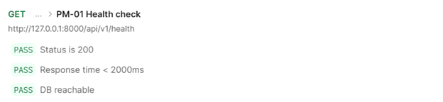
*Figure 1: Health check and registration API testing.*

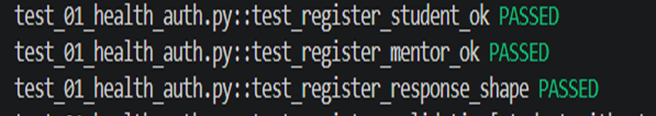
*Figure 2: Session management, token authentication, and bearer validations.*

---

### 3.2 Role-Based Access Control (RBAC) Matrix
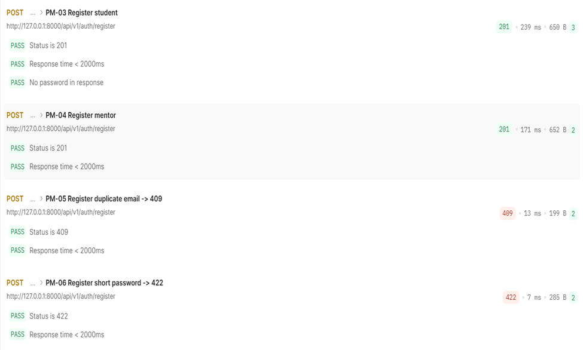
*Figure 3: RBAC permission matrix checks across anonymous, student, mentor, and admin.*

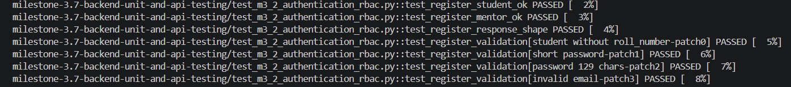
*Figure 4: Role boundary enforcement across all endpoints.*

---

### 3.3 Profiles & Guidance Areas
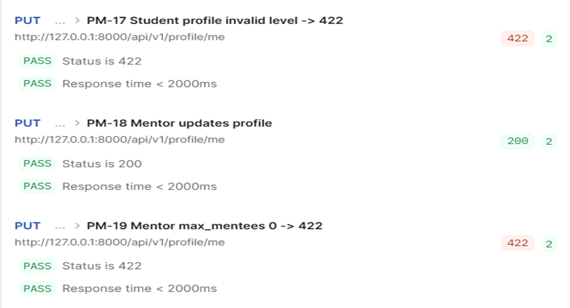
*Figure 5: Profile creation, validation, and update handling.*

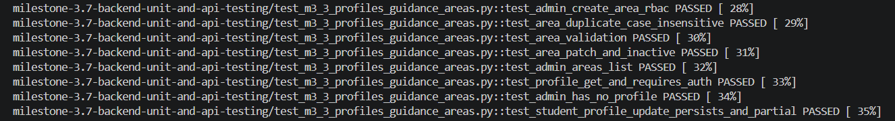
*Figure 6: Guidance area mappings and admin verification workflow.*

---

### 3.4 Mentor Discovery & Matching
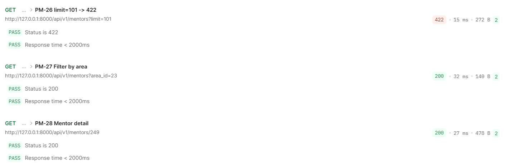
*Figure 7: Filtered mentor search and availability sorting.*

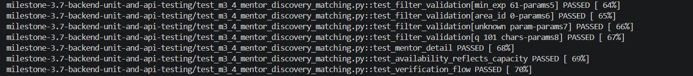
*Figure 8: Guidance overlap match score calculation.*

---

### 3.5 Mentoring Requests & Relationship Lifecycle
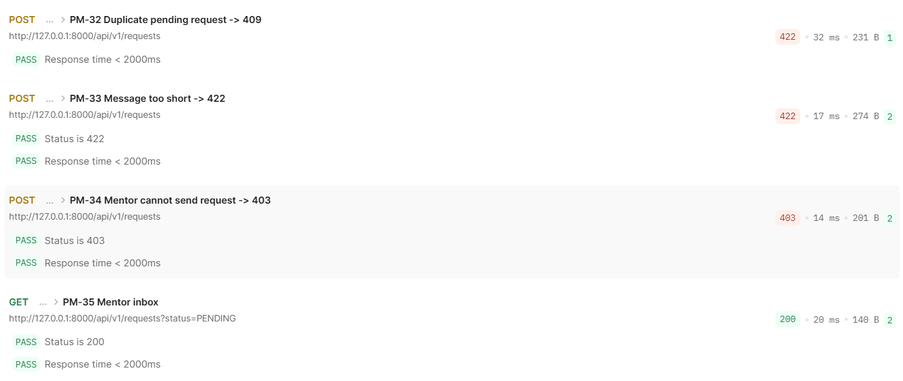
*Figure 9: Request creation, duplicate prevention, and accept/reject flows.*

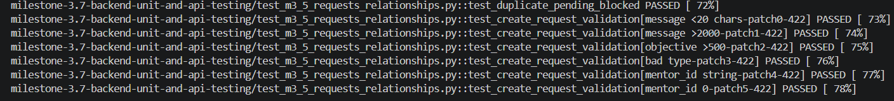
*Figure 10: Mentoring relationship lifecycle and capacity management.*

---

### 3.6 Goals, Activities, Feedback & Notifications
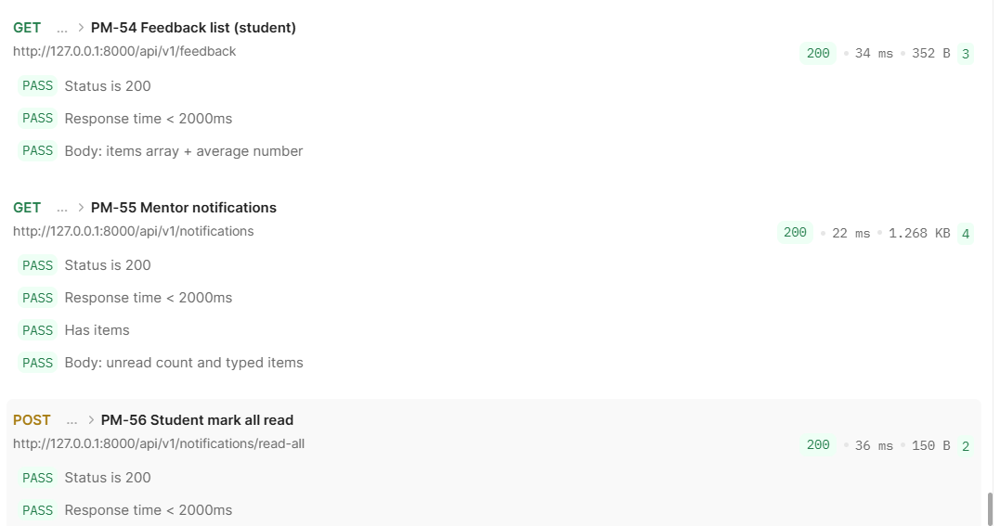
*Figure 11: Collaborative goal creation and activity logging.*

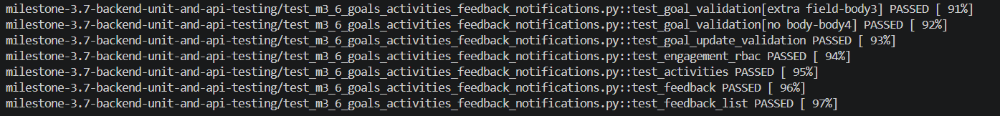
*Figure 12: Feedback exchange, rating enforcement (1-5), and notifications.*

---

### 3.7 End-to-End Multi-Role Scenarios
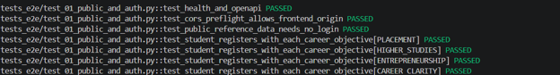
*Figure 13: End-to-end scenario test suite execution.*

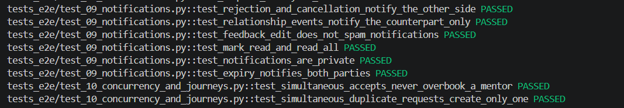
*Figure 14: Comprehensive scenario pass results.*

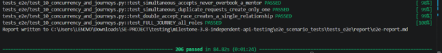
*Figure 15: Concurrency, capacity limits, and multi-role journeys.*
